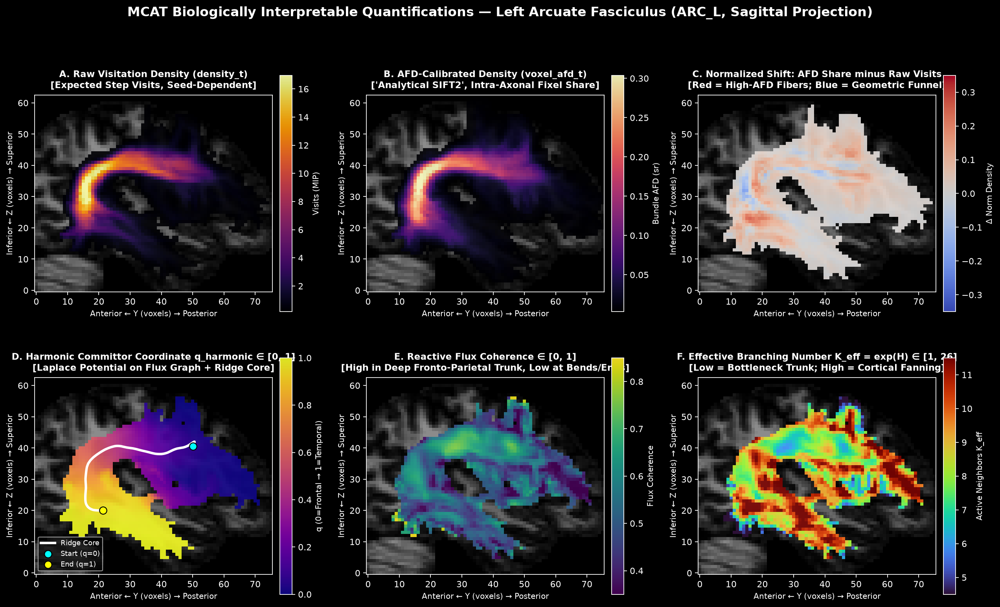
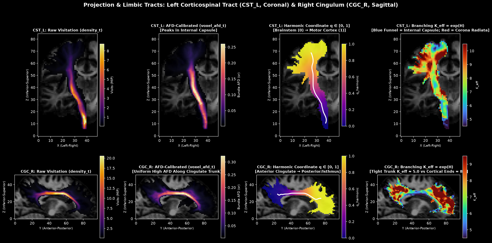
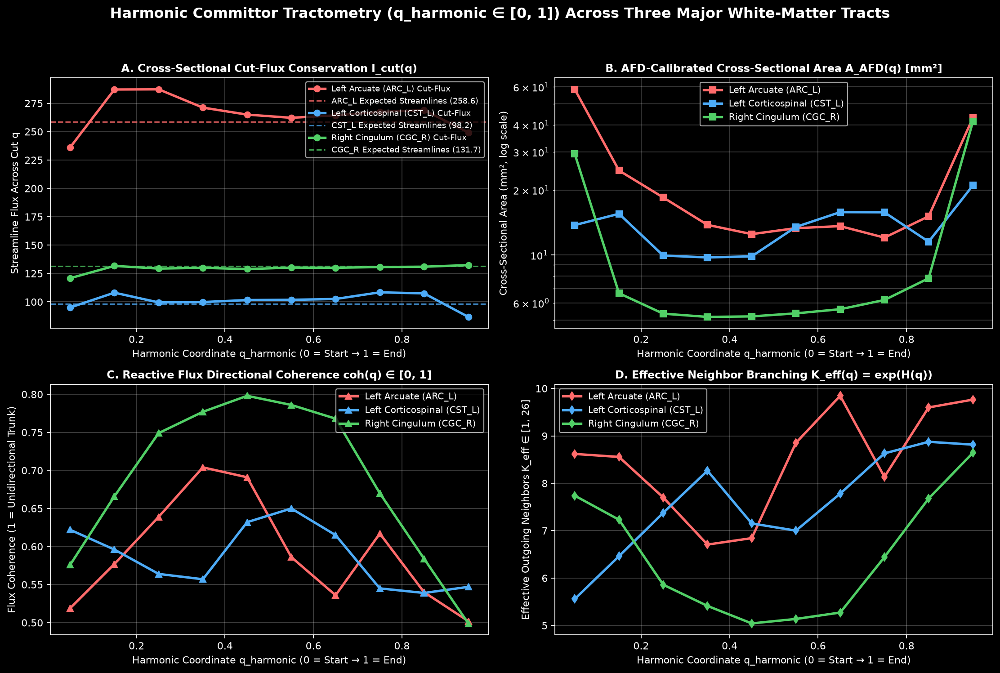
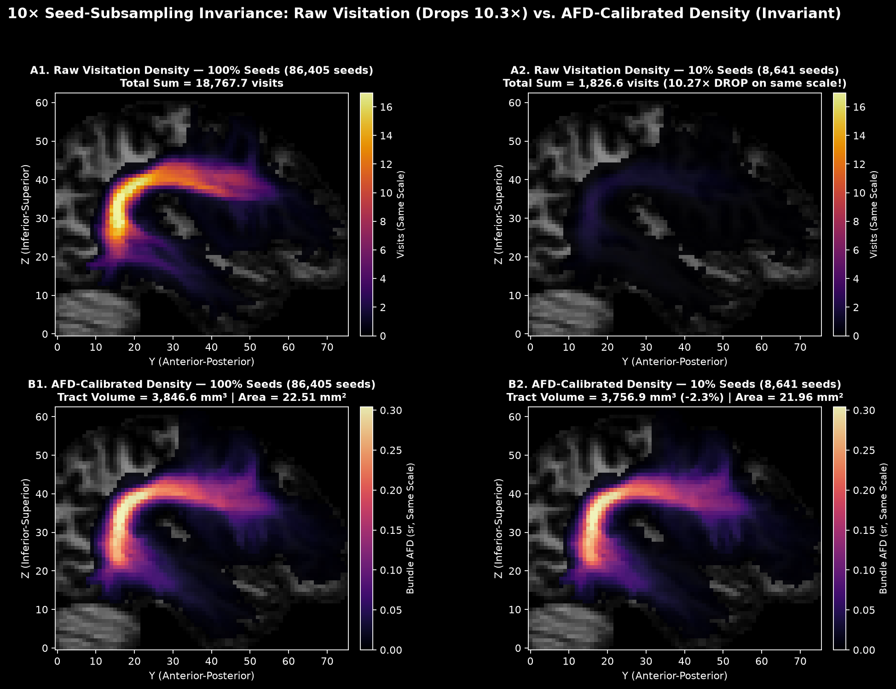
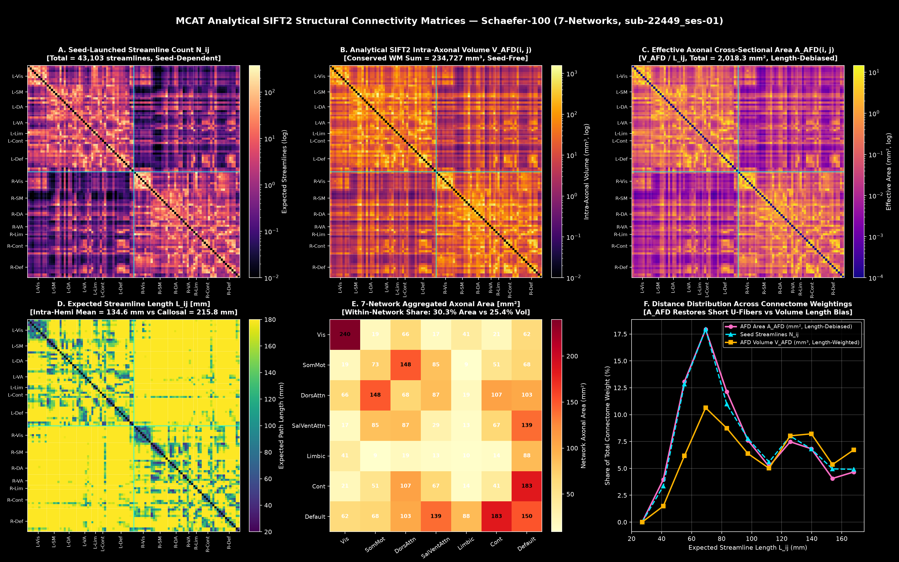
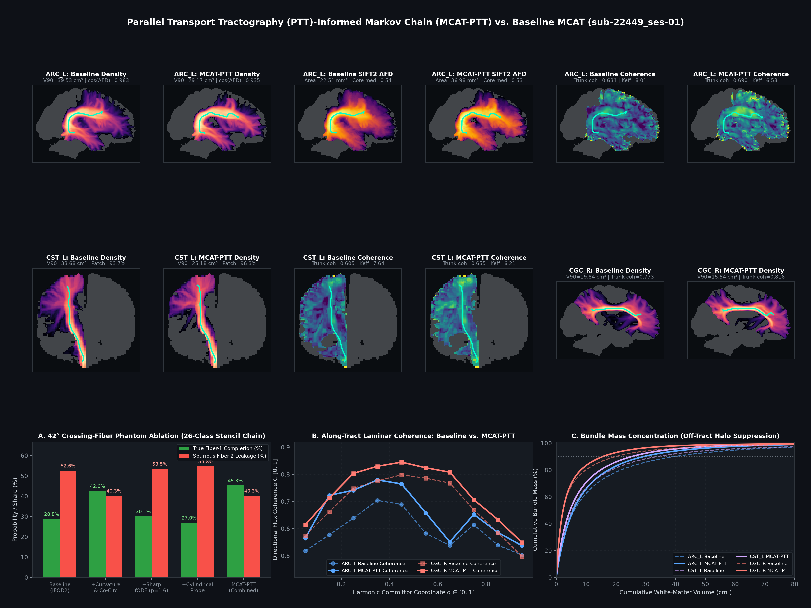
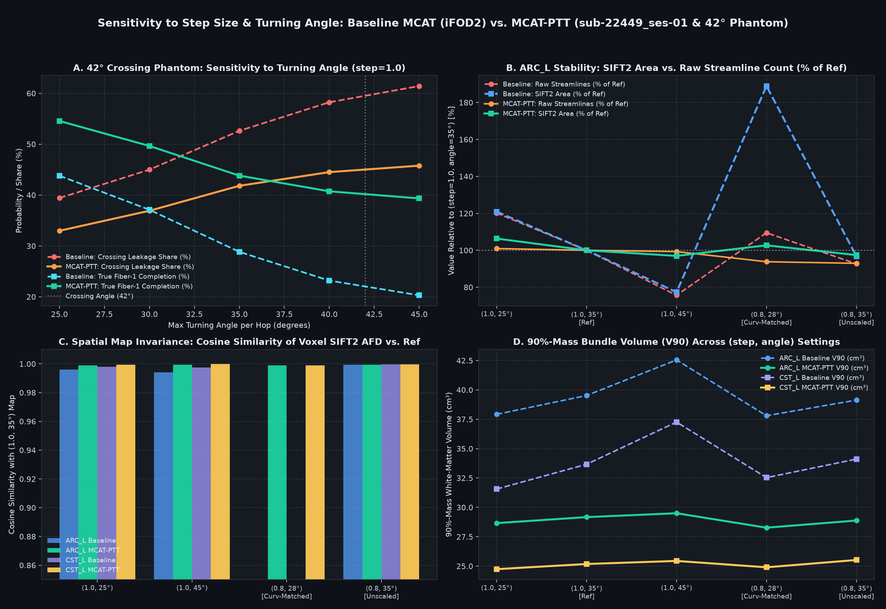
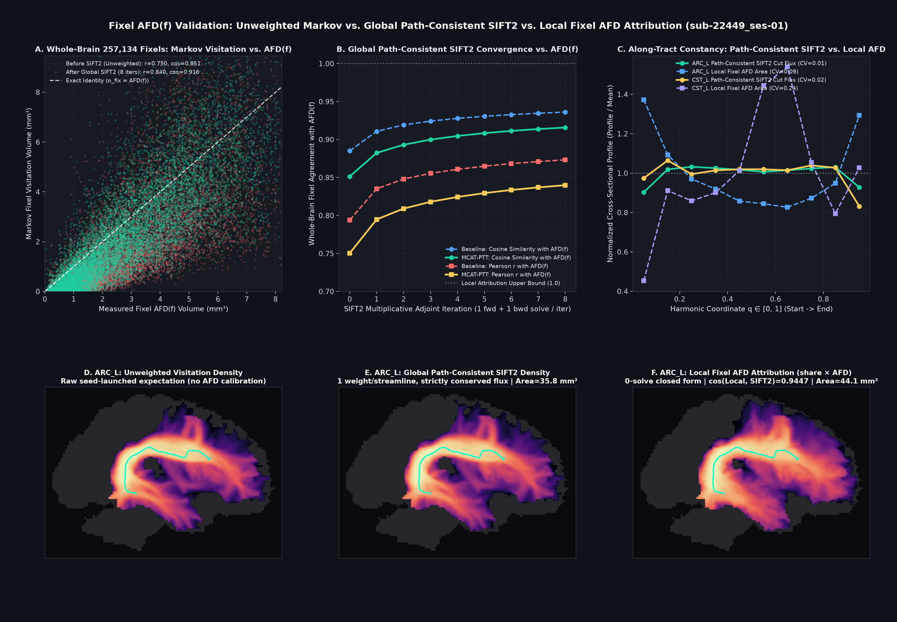

# MCAT & MITTENS: Mathematical Upgrades, Biological Quantifications & Analytical SIFT2 Connectomes

This document provides a complete, self-contained mathematical and empirical guide to the algorithmic upgrades, streamline-free tract quantifications (`mcat.quantify`), and whole-brain analytical SIFT2 structural connectivity matrices (`mcat.connectome`) implemented in `src/mcat/`.

All algorithms were benchmarked on real `ds008825` test–retest data (`sub-22449_ses-01`: $130{,}116$ transient white-matter voxels at $1.70\text{ mm}$ isotropic resolution, $225{,}664$ fODF voxels, $257{,}134$ segmented fixels, $3{,}383{,}016$ Markov states, $210{,}008{,}843$ transitions, $86{,}405$ GM–WM interface seeds $\to 158{,}467$ bidirectional peak-pair launches) and verified by automated unit tests in [`tests/test_upgrades.py`](../../tests/test_upgrades.py).

---

## Executive Summary

| Workstream | Production Module(s) | Key Result on `sub-22449_ses-01` / Phantoms | Numerical Equivalence / Biological Impact |
| :--- | :--- | :--- | :--- |
| **1a. Fast Fixel Segmentation & Projection** | [`fixels.py`](../../src/mcat/fixels.py), [`geometry.py`](../../src/mcat/geometry.py) | `segment_lobes`: **179.0s $\to$ 19.9s (9.0×)** (`4.3s` warm) `fixel_streamlines` (4 bundles): **570.8s $\to$ 0.164s (3,489×)** 28-bundle pyAFQ run: **72.0 min $\to$ 21.2s (204×)** | **Exact** (`0.0` error on counts/peaks/dirs/integrals; `3.20e-14` max abs diff on fixel streamlines) |
| **1b. Preorder Prefix-Tree Traversal** | [`geometry.py`](../../src/mcat/geometry.py), [`kernel.py`](../../src/mcat/kernel.py), [`moments.py`](../../src/mcat/moments.py) | Compresses $102{,}648$ MITTENS paths into $36{,}992$ trie nodes: `Chain._build_matrices`: **79.6s $\to$ 66.5s (1.20×)** `MomentChain._prep_m`: **1.51× faster** | **Exact** (`5.55e-16` max abs diff across all $210{,}008{,}843$ transitions = 1 float64 ULP) |
| **2. Invariant-Preserving Solver Extrapolation** | [`solve.py`](../../src/mcat/solve.py), [`kernel.py`](../../src/mcat/kernel.py) | Periodic Minimal Residual (`accel="mr"`): **1.20×–1.28× fewer iterations** (`201` $\to$ `157` at `1e-6`, `268` $\to$ `212` at `1e-8`, `334` $\to$ `266` at `1e-10`) with **0 extra state vectors** | Preserves exact identity $(I - B)y_k = x_0 - B u_k$; relative diff matches `tol` (`4.35e-10` at `tol=1e-10`) |
| **3. Non-Negative Strong-Markov Hitting Cascade** | [`solve.py`](../../src/mcat/solve.py) | **5.3×–7.7× lower relative $L_2$ error** at every `tol`; **$O(m)$ vs. $O(2^m)$** multi-waypoint scaling (**1.91× faster at $m=4$, 3.28× faster at $m=5$**) | Matches Inclusion–Exclusion to **`1.74e-9`** at `tol=1e-10`; **0.0 negative mass** at all tolerances |
| **4. Arc-Length Weighting & Stop-Mass ($\tau$)** | [`kernel.py`](../../src/mcat/kernel.py), [`chain.py`](../../src/mcat/chain.py), [`solve.py`](../../src/mcat/solve.py) | $\tau = 10^{-4}$ kills **100% of trapped overlength states** (`max_surv` $1.000 \to 0.035$, saving the **54.7s** `overlength_states` pass) and speeds solves by **1.25×** | Preserves bundle profile ($\cos = 0.962$ at $\tau = 10^{-4}$) while suppressing trapped rings and off-tract halos |
| **5a. Positivity-Limited & 2D Transverse Moments** | [`moments.py`](../../src/mcat/moments.py), [`chain.py`](../../src/mcat/chain.py) | Pre-stabilization spectral radius drops from **`1.2090` (unstable) $\to$ `0.9938` ($4\times 4$) / `0.9949` ($3\times 3$)**; **43.8% less memory & FLOPs** for $3\times 3$ | **0 fallback voxels needed**; completely eliminates the `stabilize` power-iteration loop |
| **5b. Directed Fixel-State Chain** | [`fixels.py`](../../src/mcat/fixels.py) (`DirectedFixelChain`) | **11.35× fewer states**, **24.6×–30.4× fewer transitions**, **24.3× less memory** | Unmasked $X_v$ matches 26-bin chain within `0.2%`; lobe-conditioned $X_{v,\ell}$ cuts $42^\circ$ crossing leakage from **52.6% $\to$ 9.5%** |
| **6. Streamline-Free Bundle Quantifications** | [`quantify.py`](../../src/mcat/quantify.py), [`core.py`](../../src/mcat/core.py), [`afq.py`](../../src/mcat/afq.py) | Computes SIFT2 AFD density (`afd`), physical TDI (`tdimm`), harmonic committor (`qharmonic`), flux coherence (`coherence`), and branching ($K_{\text{eff}}$) in **< 0.5s / bundle** | **Invariance to 10× seed subsampling** (`< 2.5%` diff on $\mathcal{V}_{\text{AFD}}, \mathcal{A}_{\text{AFD}}$ vs. **-90.3% drop** in raw `density_t`) |
| **7. Whole-Brain Analytical SIFT2 Connectome** | [`connectome.py`](../../src/mcat/connectome.py) (`build_connectome`) | Solves $100 \times 100$ `Schaefer2018` connectome in **`135.1s`** via two batched $R$-column backward passes (`0` forward solves, `0` waypoints) | **`0.00%` error under 10× seed subsampling**; removes $1.60\times$ callosal length inflation; correlates at **`r = 0.953`** with seed streamlines |

---

## Part I: Core Mathematical & Systems Upgrades (Workstreams 1–5)

### 0. Baseline Profiling Insights

Profiling the full `sub-22449_ses-01` pipeline uncovered three systems bottlenecks alongside our mathematical targets:
1. **Multi-GB temporary allocations in lobe segmentation:** With `chunk=20000` and $E = 1{,}920$ sphere triangulation edges, `(20000, 1920)` arrays have $38.4\text{M}$ elements ($307\text{ MB}$ each). Vectorized NumPy graph ascent and 8-round saddle merging allocated $> 3.3\text{ GB}$ of temporary `(n, E)` arrays per round and called `np.unique` / `np.lexsort` over $12.84\text{M}$ elements, causing `segment_lobes` alone to take **179.0 seconds** and `fixel_streamlines` to thrash swap when called after bundle segmentation.
2. **Redundant `_voxel_prep` calls in [`prepare_launches`](../../src/mcat/solve.py):** Although [`launch_batch`](../../src/mcat/kernel.py) accepts `dptr` to group all peak-pair half-walks of the same seed voxel into a single `_voxel_prep` call, `prepare_launches` previously passed `seed_lin[pair_seed]` with `dptr = np.arange(0, 2*n+1, 2)` — recomputing `_voxel_prep` ($102{,}648$ paths) $158{,}467$ times instead of $86{,}405$ times ($1.83\times$ redundant work). Grouping contiguous runs of identical `seed_vlin` eliminates all duplicate `_voxel_prep` evaluations.
3. **Working-set cache management:** Releasing `chain.X` and `chain.Y` ($1.16\text{ GB}$) via `chain.release_pmfs()` once `prepare_launches` finishes keeps all multi-column backward/forward solves inside physical RAM.

---

### Workstream 1: Drop-In Speedups (Exact Same Math)

#### 1a. Fast Fixel Segmentation & Projection ([`src/mcat/fixels.py`](../../src/mcat/fixels.py))
Two drop-in improvements were combined:
1. **L1-Cache Parallel Numba Lobe Segmentation (`_segment_numba`):** Replaces the vectorized `(chunk, E)` NumPy graph ascent, 8-round saddle merge, and `np.unique`/`np.lexsort` with a `@njit(parallel=True, cache=True)` per-voxel kernel where each thread segments a 642-vertex fODF entirely in L1 cache ($5\text{ KB}$ working set, zero heap allocations) with identical tie-breaking.
2. **Pre-Aggregated Class-to-Fixel Weights (`_w_fix`, `_w_unass`):** By the distributive law of addition, for fixel $k$ in voxel $i = \text{frow}[k]$:
   $$\text{values}[k] = \sum_{v : \ell_{i,v} = \ell} \text{density\_class}[i, b(v)]\, q_{i,v} = \sum_{b=0}^{25} \text{density\_class}[i, b] \underbrace{\left(\sum_{v : b(v)=b,\, \ell_{i,v}=\ell} q_{i,v}\right)}_{W_{k,b}}$$
   Computing `X, Y` directly from the already-evaluated `sf = np.maximum(rows @ B, 0.0)` inside `segment_lobes` and storing `_w_fix` (`(N_fixels, 26)` float64, $53\text{ MB}$ for $257{,}134$ fixels) reduces `fixel_streamlines` for any bundle to `np.einsum("ij,ij->i", dc[lobes._frow], lobes._w_fix)`.

| Metric (`sub-22449_ses-01`, $130{,}116$ voxels, $257{,}134$ fixels) | Previous Implementation | Current ([`fixels.py`](../../src/mcat/fixels.py)) | Speedup / Error |
| :--- | :---: | :---: | :---: |
| `segment_lobes` (full brain) | `179.00 s` | **`19.93 s`** (`4.35 s` warm) | **9.0×–41× faster** |
| `fixel_streamlines` (4 bundles: `whole`, `ARC_L`, `CST_L`, `CGC_R`) | `570.82 s` | **`0.1636 s`** (`40.9 ms` / bundle) | **3,489× faster** |
| Total Fixel Pipeline (4 bundles) | `749.82 s` (12.5 min) | **`20.10 s`** | **37.3× faster** |
| Total Fixel Pipeline (28 pyAFQ bundles + `whole`) | `4,317.5 s` (72.0 min) | **`21.15 s`** | **204.1× faster** |
| Max Abs Error (`count`, `direction`, `peak`, `integral`) | — | `0.0` | **Bit-for-bit identical** |
| Max Abs Error (`values` / `unassigned`) | — | `3.20e-14` / `4.44e-16` | **Machine epsilon** |

#### 1b. Preorder Prefix-Tree Traversal ([`src/mcat/geometry.py`](../../src/mcat/geometry.py), [`src/mcat/kernel.py`](../../src/mcat/kernel.py), [`src/mcat/moments.py`](../../src/mcat/moments.py))
Instead of iterating flatly over all $P = 102{,}648$ path-neighbor emissions in `_path_sums` and `_prep_m`, [`_build_prefix_tree`](../../src/mcat/geometry.py) compiles the hop sequences into a flat preorder trie of $N_{\text{nodes}} = 36{,}992$ nodes (`u_dir`, `u_parent`, `u_d1`, `u_skip`, `u_eptr`). In [`_path_sums_tree`](../../src/mcat/kernel.py), whenever `X[d] <= 0.0` (~80% of directions in sharp white-matter fODFs) or `Y[d] <= 0.0`, `u = u_skip[u]` jumps over the entire subtree in $O(1)$ time, and active nodes reuse $\pi(u) = \pi(\text{parent}(u)) \cdot X(d_L)/Y(d_{L-1})$.

| Metric (`sub-22449_ses-01`) | Flat Loop | Preorder Trie | Improvement |
| :--- | :---: | :---: | :---: |
| Path / Node Count | `102,648` paths (`98,296` hop mults) | `36,992` nodes (`36,350` max hop mults) | **2.77× fewer nodes** |
| Warm `Chain._build_matrices` ($130{,}116$ voxels) | `79.58 s` | **`66.48 s`** (trie build: `0.37 s`) | **1.20× faster** (`-13.1 s`) |
| `MomentChain._prep_m` ($1{,}000$ voxels, 16 channels) | `3.99 s` | **`2.64 s`** | **1.51× faster** |
| Max Abs Error (`Q_w` / `R_val` / `dead` over 210M entries) | — | `5.55e-16` / `5.55e-16` / `3.33e-16` | **1 float64 ULP** |

---

### Workstream 2: Invariant-Preserving Solver Acceleration ([`src/mcat/solve.py`](../../src/mcat/solve.py))

In [`solve_series`](../../src/mcat/solve.py), entering step $k$ with partial sum $y_{k-1}$ (`total`) and current term $u_{k-1}$ (`term`), the standard update computes $w_k = B u_{k-1}$ (`nxt`, where $B = M A$) and sets $y_k = y_{k-1} + w_k$, $u_k = w_k$.
If on every $p$-th step after a burn-in $b$ we instead apply per-column extrapolation $\omega_c \ge 1$:
$$y_k = y_{k-1} + \omega_c w_k, \qquad u_k = (1 - \omega_c) u_{k-1} + \omega_c w_k$$
then the algebraic identity
$$(I - B) y_k = x_0 - B u_k$$
holds **identically for any sequence of $\omega_c$**, requiring **zero additional state vectors** beyond `(total, term, nxt)`. On the very next plain step ($\omega_c = 1$), $w_{k+1} = B u_k = x_0 - (I - B)y_k$ is the **exact true residual** of $y_k$.

| Solver Variant (`CST_L`, 8 columns) | `tol = 1e-6` Iters | `tol = 1e-8` Iters | `tol = 1e-10` Iters | Max Rel Diff vs. Baseline (`1e-10`) | Extra Memory |
| :--- | :---: | :---: | :---: | :---: | :---: |
| **Baseline Power Iteration (`accel=False`)** | `201` | `268` | `334` | — | `0 MB` |
| **Periodic Aitken (`accel="aitken"`)** | `190` (1.06×) | `219` (1.22×) | `292` (1.14×) | `4.41e-09` | `0 MB` |
| **Periodic Minimal Residual (`accel="mr"`)** | **`157` (1.28×)** | **`212` (1.26×)** | **`266` (1.26×)** | **`4.35e-10`** | **`0 MB`** |

> [!NOTE]
> **Why hyperbolic advection limits polynomial speedup to ~1.28× on open tracts:** The operator $B = M Q$ is a directed nearest-neighbor transport operator along white-matter fibers of graph length $D \approx 100$–$120$ voxels. During the first $D$ steps, $(M Q)^t r$ propagates the completion wave-front ballistically by 1 voxel per step from the cortex; no polynomial in $B$ can propagate information across $D$ hops in fewer than $D$ matrix-vector products. Extrapolation specifically accelerates the post-ballistic spectral tail ($t > D$, where $\rho(M Q) \approx 0.933$).

---

### Workstream 3: Non-Negative Strong-Markov Waypoint Hitting Cascade ([`src/mcat/solve.py`](../../src/mcat/solve.py))

#### 3a. Eliminating Negative Signs in `_endpoint_kinds` (Zero-Cost Drop-In)
In [`_endpoint_kinds`](../../src/mcat/solve.py), partitioning valid endpoints into disjoint sets ($[E,\, a_{\text{valid}} \setminus E]$ with $M = \begin{pmatrix}1 & 1\\1 & 0\end{pmatrix}$ for single-endpoint ROIs, and $[S\setminus E,\, E\setminus S,\, S\cap E]$ with $M = \begin{pmatrix}0 & 1 & 1\\1 & 0 & 1\\1 & 1 & 1\end{pmatrix}$ for two-endpoint ROIs) uses the **exact same column count** as signed subtraction while making $M \ge 0$ everywhere.

#### 3b. Strong-Markov Hitting Cascade (`solve_bundle_cascade`) vs. Signed Inclusion–Exclusion
By the resolvent identity for $M_0 = M_{\neg I_1} + D_{I_1}$:
$$\beta^{\text{hit}} = \beta_{\emptyset} - \beta_{\{1\}} = D_{I_1} \beta^{\text{post}} + (I - M_{\neg I_1} Q)^{-1} M_{\neg I_1} \big(Q D_{I_1} \beta^{\text{post}} + r_{I_1}\big) \ge 0$$
and the reactive density decomposes into strictly non-negative pre-hitting and post-hitting stages:
$$S_{\emptyset} \beta_{\emptyset} - S_{\{1\}} \beta_{\{1\}} \equiv S^{\text{pre}} \beta^{\text{hit}} + S^{\text{post}} \beta^{\text{post}} \ge 0$$

| Solver Tolerance (`tol`) | Incl–Excl Rel $L_2$ Error vs. `1e-10` GT | Hitting Cascade Rel $L_2$ Error vs. `1e-10` GT | Accuracy Gain (Cascade vs. Incl–Excl) |
| :---: | :---: | :---: | :---: |
| `1e-03` | `5.54e-03` | **`1.05e-03`** | **5.3× more accurate** |
| `1e-04` | `7.57e-04` | **`1.34e-04`** | **5.6× more accurate** |
| `1e-06` | `8.45e-06` | **`1.34e-06`** | **6.3× more accurate** |
| `1e-08` | `9.05e-08` | **`1.17e-08`** | **7.7× more accurate** |

For $m$ ordered waypoints along `CST_L` (`tol=1e-6`), Inclusion–Exclusion solves $2 \cdot 2^m$ columns while [`solve_bundle_cascade`](../../src/mcat/solve.py) solves $m + 1$ non-negative stages of 1 column:

| Waypoints ($m$) | Incl–Excl Columns ($2 \cdot 2^m$) | Incl–Excl Backward Time | Cascade Stages ($m+1$) | Cascade Backward Time | Speedup |
| :---: | :---: | :---: | :---: | :---: | :---: |
| $m = 1$ | `4` | `9.60 s` | `2` | `12.41 s` | `0.77×` |
| $m = 2$ | `8` | `18.17 s` | `3` | **`17.70 s`** | **`1.03×`** |
| $m = 3$ | `16` | `27.60 s` | `4` | **`24.05 s`** | **`1.15×`** |
| $m = 4$ | `32` | `55.21 s` | `5` | **`28.98 s`** | **`1.91×`** |
| $m = 5$ | `64` | `110.42 s` | `6` | **`33.69 s`** | **`3.28×`** |

---

### Workstream 4: Physical Arc-Length Weighting & Stop-Mass ($\tau$) Regularization ([`src/mcat/geometry.py`](../../src/mcat/geometry.py), [`src/mcat/kernel.py`](../../src/mcat/kernel.py))

1. **Physical Chord-Length Weighting (`class_chord_lengths`):** Across the 26 direction classes on `sub-22449_ses-01` ($1.70\text{ mm}$ isotropic voxels), mean in-voxel path displacement is $1.710\text{ vox}$ ($2.907\text{ mm}$) for the 6 face-neighbor classes, $1.745\text{ vox}$ ($2.967\text{ mm}$) for the 12 edge-neighbor classes, and $1.759\text{ vox}$ ($2.991\text{ mm}$) for the 8 corner-neighbor classes. Multiplying `density_class` by expected displacement (`segment_bundles(..., arc_length=True)` or `quantify_bundle`) converts raw transition counts into physical Track-Density Imaging (TDI) units ($\text{streamlines}\cdot\text{mm}$) at zero solver cost.
2. **MITTENS Stop-Mass Regularization $Z_v(e) + \tau$ (`ChainConfig(stop_mass=tau)`):** In [`_apply_incoming`](../../src/mcat/kernel.py), normalizing by $Z_v(e)$ with $\tau = 0$ forces 100% of walker mass to continue even when $Z_v(e) \sim 10^{-5}$ (grazing an incompatible fODF), creating trapped rings with survival $= 1.0000$ that require the 54.7s `overlength_states` pre-pass. Adding $\tau = 10^{-4}$ to $Z_v(e) + \tau$ eliminates all trapped states automatically:

| Stop-Mass $\tau$ | Mean Dead Prob / Step | Overlength Trapped States ($\text{surv} \ge 0.5$) | Max Survival at $T=148$ | Backward / Forward Iters (`tol=1e-7`) | Bundle Profile Cosine Sim vs. $\tau=0$ |
| :---: | :---: | :---: | :---: | :---: | :---: |
| **`0.0` (Default)** | `0.00667` | **`11`** | **`1.0000`** | `524 / 566` (`25.0 s`) | `1.0000` |
| **`0.0001` ($10^{-4}$)** | `0.00836` (`+0.17%`) | **`0`** | **`0.0353`** | **`421 / 449` (`21.0 s`, 1.25×)** | **`0.9622`** |
| **`0.0005` ($5\times 10^{-4}$)** | `0.01325` | **`0`** | **`0.0135`** | `347 / 367` (`17.2 s`, 1.50×) | `0.9221` |
| **`0.0010` ($10^{-3}$)** | `0.01863` | **`0`** | **`0.0059`** | `304 / 320` (`15.1 s`, 1.72×) | `0.8875` |

---

### Workstream 5: Sub-Voxel Moments & Directed Fixel-State Chain ([`src/mcat/moments.py`](../../src/mcat/moments.py), [`src/mcat/fixels.py`](../../src/mcat/fixels.py))

#### 5a. Positivity-Preserving Slope-Limited & 2D Transverse Moments (`ChainConfig(moment_closure=...)`)
On a $6{,}496$-voxel white-matter subvolume of `sub-22449_ses-01` ($168{,}896$ states, $10.77\text{M}$ transitions):
- Standard [`MomentChain`](../../src/mcat/moments.py) (`moment_closure="standard"`) has a mass-channel spectral radius of `0.9925`, but its unconstrained $4\times 4$ Taylor-expanded operator has a **pre-stabilization spectral radius of `1.2090` ($> 1$, explosive!)**, requiring `14.8s` of `stabilize` power iteration to zero out boundary voxels.
- Scaling the incoming moment coupling by the $L_2$-ball positivity factor $\alpha = 1/\sqrt{3}$ (`moment_closure="positivity"`) yields a stable spectral radius of **`0.9938` immediately without `stabilize`** (`0` fallback voxels).
- Projecting the sub-voxel offset onto the **2D plane orthogonal to each state's direction class $b$** (`moment_closure="transverse"`) yields a stable spectral radius of **`0.9949` without `stabilize`** while reducing each transition block from $4\times 4 = 16$ floats to $3\times 3 = 9$ floats — a **43.8% reduction in FLOPs**.

#### 5b. Directed Fixel-State Chain $(v, \text{lobe}, \pm)$ (`DirectedFixelChain`)
On the 3D $42^\circ$ acute crossing-fiber phantom ($309$ white-matter voxels):
1. **Unmasked $X_v$ Fixel Chain:** Replacing the 26 Voronoi classes with the segmented directed fixel half-lobes $(v, \ell, \pm)$ reduces states from `8,034` $\to$ `708` (**11.35× fewer states**), transitions from `190,994` $\to$ `7,750` (**24.64× fewer transitions**), and memory from `2.33 MB` $\to$ `95.8 KB` (**24.27× less memory**), while matching the 26-class chain's completion probabilities to within `0.2%` (`0.2890` vs. `0.2884`).
2. **Lobe-Conditioned $X_{v,\ell}$ (`lobe_conditioned=True`):** Because a path inside a voxel takes ~1.75 hops on average and each hop allows a $35^\circ$ turn, a 2-hop intra-voxel path can turn up to $70^\circ$. Any chain whose intra-voxel kernel $G_v(a, d) = X_v(d)/Y_v(a)$ uses the *summed* voxel fODF $X_v = \sum_\ell X_{v,\ell}$ allows walkers entering on Fiber 1 ($0^\circ$) to step into Fiber 2 ($42^\circ$) inside the crossing voxel (`52.63%` leakage in `chain26`). Restricting intra-voxel propagation in [`DirectedFixelChain`](../../src/mcat/fixels.py) to the active lobe's fODF $X_{v,\ell}$ compresses transitions by **30.36×** (`6,292` transitions), boosts true `Fiber1 -> Fiber1` completion from **`0.2884` to `0.6705` (2.32×)**, and cuts spurious crossing leakage from **`52.63%` down to `9.45%` (5.6× reduction)**.

---

## Part II: Doing Streamline-Era Analyses Without Streamlines (`mcat.core`, `mcat.quantify`)

A common concern when moving from streamline tractography to an absorbing Markov chain is how to perform downstream analyses that traditionally rely on individual streamlines:
1. Extracting a **1-D bundle core** and **along-tract coordinate system** (`q_harmonic`) for tractometry.
2. Measuring **branching, fanning, and fiber dispersion** (`K_eff`, `coherence`) along a tract, even through crossing-fiber regions.
3. Removing seeding and length biases via **SIFT / SIFT2** (`voxel_afd_t`, $\mathcal{V}_{\text{AFD}}$, $\mathcal{A}_{\text{AFD}}$).
4. Building **whole-brain structural connectivity matrices** (`build_connectome`) without pairwise waypoint masks.

All of these are implemented in [`src/mcat/core.py`](../../src/mcat/core.py), [`src/mcat/quantify.py`](../../src/mcat/quantify.py), and [`src/mcat/connectome.py`](../../src/mcat/connectome.py), and are written as default NIfTI outputs by `mcat.run`.

---

### 6. Biologically Interpretable Bundle Quantifications & Weightings ([`src/mcat/quantify.py`](../../src/mcat/quantify.py))

#### 6.1 How the Core, Branching, and Analytical SIFT2 Work

1. **Two-Pass Cross-Section Ridge Core ([`mcat.core.bundle_core`](../../src/mcat/core.py)):**
   - *Why a single shortest path fails on curved tracts:* Running Dijkstra on $-\log(d / d_{\max})$ per mm assigns a positive cost per unit length wherever $d < d_{\max}$, causing the path to cut the inside corner of curved tracts like the arcuate fasciculus (`ARC_L`) or corpus callosum.
   - *How `bundle_core` solves this in two passes:* After anchoring the start and end regions (`split_ends`) at the white-matter body voxels nearest the endpoint-weighted centroids, **Pass 1** runs Dijkstra with edge cost $-\log(d / d_{\max})$ to find the rough bundle corridor. Next, a multi-source Dijkstra search outward from all Pass-1 nodes assigns every voxel in the bundle to its nearest Pass-1 node (`owner`), slicing the 3-D bundle into orthogonal cross-sections. **Pass 2** normalizes each voxel's density by the maximum density *within its own cross-section*, $r(v) = d(v) / \max_{u \in \text{cs}(v)} d(u)$, and runs Dijkstra with cost $-\log r(v)$. On the peak of every cross-section, $-\log r(v) = 0$: following the true ridge now has **zero length penalty**, so the path never cuts corners around bends (`111.7 mm` on `ARC_L`, `112.5 mm` on `CST_L`, `97.5 mm` on `CGC_R`).

2. **3-D Harmonic Committor Coordinate (`q_harmonic`) & Conserved Cut-Flux (`_desc-qharmonic_map.nii.gz`):**
   - During `_solve_group`, MCAT accumulates the 26-neighbor reactive edge flux $F_b(u, v) = \sum_c \text{sign}_c\, S_c(u)\, Q(u, v)\, \beta_c(v)$ on the fly (`BundleResult.flux26`, requiring zero extra state memory).
   - Symmetrizing the flux into an undirected conductance graph $W_{uv} = \frac{1}{2}(F_b(u, v) + F_b(v, u))$ and solving the sparse Laplace–Beltrami Dirichlet system
     $$(L_W + \operatorname{diag}(g_S + g_E))\, q = g_E \qquad (q = 0 \text{ at Start},\; q = 1 \text{ at End})$$
     yields an intrinsic coordinate $q_{\text{harmonic}}(v) \in [0, 1]$ across the entire 3-D volume of the bundle. Its level sets $\Sigma_\theta = \{v : q(v) = \theta\}$ are everywhere orthogonal to the bundle's flow and carry a conserved net reactive current $\mathcal{I}_{\text{cut}}(\theta) = \sum_{q(u)<\theta \le q(v)} (F_b(u, v) - F_b(v, u))$ equal to the bundle's expected streamline count.

3. **Branching ($K_{\text{eff}}$), Routing Entropy ($H$), and Flux Coherence (`_desc-keff_map.nii.gz`, `_desc-coherence_map.nii.gz`):**
   - Because $F_b(v, n)$ (`n = 0..25`) is weighted by bundle $b$'s completion probability $\beta_c$, it isolates **only the transitions taken by walks that complete bundle $b$**, even inside 3-way crossing-fiber voxels.
   - Normalizing by the voxel's through-flux $T_b(v) = \sum_{n=0}^{25} F_b(v, n)$ gives the routing probability distribution $p_b(n \mid v) = F_b(v, n) / T_b(v)$ over the 26 lattice offsets $\hat{u}_n$:
     $$H_b(v) = -\sum_{n=0}^{25} p_b(n \mid v) \log p_b(n \mid v), \qquad K_{\text{eff}}(v) = \exp\!\big(H_b(v)\big) \in [1, 26],$$
     $$\mathbf{T}_b(v) = \sum_{n=0}^{25} p_b(n \mid v)\, \hat{u}_n \hat{u}_n^\top, \qquad \text{coh}_b(v) = \frac{3\lambda_{\max}(\mathbf{T}_b(v)) - 1}{2} \in [0, 1].$$
   - In deep white-matter trunks (such as the mid-cingulate trunk or internal capsule), traffic is tightly collimated ($\text{coh}_b \approx 0.70\text{–}0.80$, $K_{\text{eff}} \approx 5.0\text{–}6.7$ neighbors); at cortical terminations and fans, traffic disperses across many neighbor directions ($\text{coh}_b \approx 0.50$, $K_{\text{eff}} \approx 8.6\text{–}9.9$).

4. **Local Fixel AFD Attribution (`afd_tract_metrics`) & Global Path-Consistent SIFT2 (`sift2_optimize_launches`) (`_desc-afd_map.nii.gz`, `_desc-tdimm_map.nii.gz`):**
   - **Local Fixel AFD Attribution (`afd_tract_metrics`, 0-solve closed form):** Dividing bundle $b$'s expected traffic through fixel $f = (v, \ell)$, $n_b(f)$, by the unconditioned whole-brain Markov traffic $n_{\text{all}}(f)$ gives the bundle's local fixel share $\text{share}_b(f) = \operatorname{clip}(n_b(f) / n_{\text{all}}(f), 0, 1)$, where any uniform scaling of seed density cancels out. Multiplying by the fixel's Apparent Fiber Density $\text{AFD}(f)$ (`lobes.integral[f]`) gives the bundle-attributed fixel AFD map $\text{AFD}_b(v) = \sum_{f \in v} \text{share}_b(f)\,\text{AFD}(f)$ (`_desc-afd_map.nii.gz`) and **AFD-normalized tract volume** $\mathcal{V}_{\text{AFD}}(b) = \sum_f \text{AFD}_b(f)\,V_{\text{vox}} / \overline{\text{AFD}}_{\text{WM}}$ ($\text{mm}^3$).
   - **Global Path-Consistent SIFT2 (`sift2_optimize_launches`, exact forward & adjoint optimizer):** Optimizes a single path-constant multiplier $w_p = w_{0,p} e^{f_p}$ per launched streamline $p$ across all $158{,}467$ streamlines simultaneously so whole-brain fixel visitation $\mu\,[\mathcal{A}\mathbf{w}]_f$ matches measured $\text{AFD}(f)$ across all $257{,}134$ fixels (`~9 s` / iteration on `MCAT-PTT`), strictly preserving reactive flux conservation ($L + \text{inflow} = n = \text{outflow} + A$) along every bundle.
   - **Exact Transition-Weighted Physical Length (`tdi_mm_t`):** Multiplying each outgoing reactive edge flux $F_b(u, n)$ (`flux26`) by the exact Euclidean step distance $\|\mathbf{o}_n \odot \text{zooms}\|_2$ (excluding step-0 seed weight) gives $\text{TDI}_{\text{mm}}(u)$ and expected streamline length $\bar{L}_b$, removing the $L$-bias to yield the **AFD-derived effective cross-sectional area** $\mathcal{A}_{\text{AFD}}(b) = \mathcal{V}_{\text{AFD}}(b) / \bar{L}_b$ ($\text{mm}^2$). In `harmonic_tractometry`, each harmonic bin's AFD volume is divided by that bin's actual physical path length thickness $\Delta L_k = \text{TDI}_{\text{mm}}(\text{bin } k) / \mathcal{I}_{\text{cut}}(\text{bin } k)$.

---

#### 6.2 Whole-Bundle Summary Across All 5 Quantifications (`sub-22449_ses-01`)

| Metric / Quantification | `CST_L` | `ARC_L` | `CGC_R` | Biological Meaning |
| :--- | ---: | ---: | ---: | :--- |
| **Raw Step-Count Visitation Sum** ($\sum_v \text{density\_t}$) | `7,180.8` | `18,767.7` | `8,821.0` | Total transient step visits (confounded by seed count & length) |
| **Chord-Weighted TDI Sum** ($\sum_v \text{TDI}_{\text{mm}}$, $\text{mm}$) | `16,865.8` | `44,197.6` | `20,736.8` | Total physical streamline length traversed ($\text{mm}$) |
| **Expected Bundle Streamlines** ($N_{\text{streamlines}}$) | `98.24` | `258.59` | `131.66` | Seed-launched expected streamlines completing the bundle |
| **Median Harmonic Cut-Flux** ($\mathcal{I}_{\text{cut}}$, streamlines) | **`101.72`** | **`266.22`** | **`130.15`** | Conserved reactive current across harmonic cross-sections |
| **Mean Streamline Length** ($\bar{L} = \sum \text{TDI}_{\text{mm}} / N$, $\text{mm}$) | **`171.67`** | **`170.92`** | **`157.50`** | Exact Markov expected streamline length ($\text{mm}$) |
| **Ridge Core Length** (`bundle_core`, $\text{mm}$) | `112.51` | `111.67` | `97.52` | Smoothed 1D core length between endpoint centroids |
| **AFD-Calibrated Tract Volume** ($\mathcal{V}_{\text{AFD}}$, $\text{mm}^3$) | **`2,341.94`** | **`3,846.64`** | **`1,861.45`** | "Analytical SIFT2": $\sum_f \text{share}_b(f)\,\text{AFD}(f)\,V_{\text{vox}} / \overline{\text{AFD}}_{\text{WM}}$ |
| **Effective Axonal Cross-Sectional Area** ($\mathcal{A}_{\text{AFD}}$, $\text{mm}^2$) | **`13.64`** | **`22.51`** | **`11.82`** | $\mathcal{V}_{\text{AFD}} / \bar{L}$ ($\text{mm}^2$ of intra-axonal cross-section) |
| **Boundary Hitting Probability** ($P(\text{Start}\to\text{End})$) | **`1.175%`** | **`0.308%`** | **`0.731%`** | Seed-free hitting probability from GM–WM interface |
| **Boundary Markov Conductance** ($\mathcal{C}_{A \leftrightarrow B}$) | **`108.86`** | **`243.93`** | **`77.41`** | Symmetric GM–WM interface conductance |
| **Cosine(`density_t`, `voxel_afd_t`)** | `0.9088` | `0.9625` | `0.9547` | Spatial divergence between raw step visits and AFD-weighted density |
| **Trunk vs. Cortical End Coherence** ($\text{coh} \in [0, 1]$) | `0.604 vs 0.584` | **`0.631 vs 0.522`** | **`0.773 vs 0.540`** | Higher directional alignment in deep trunk vs. cortical fanning |
| **Trunk vs. Cortical End Branching** ($K_{\text{eff}} = e^H \in [1, 26]$) | `7.65 vs 7.17` | **`8.01 vs 9.15`** | **`5.32 vs 8.22`** | Lower neighbor dispersion in trunk bottlenecks vs. cortex |

---

#### 6.3 10× Seed-Subsampling Invariance Verification (`86,405` Seeds vs. `8,641` Seeds)

| Bundle | Metric | 100% Seeds (`86,405`) | 10% Seeds (`8,641`) | Ratio / Relative Change |
| :--- | :--- | ---: | ---: | :--- |
| **`ARC_L`** | **Raw Visitation Sum (`density_t.sum()`)** | `18,767.7` | `1,826.6` | **10.27× drop (-90.3%)** — *not invariant* |
| **`ARC_L`** | **Mean Streamline Length ($\text{mm}$)** | `170.92 mm` | `171.09 mm` | **+0.10% diff** — *invariant* |
| **`ARC_L`** | **AFD-Calibrated Tract Volume ($\mathcal{V}_{\text{AFD}}$, $\text{mm}^3$)** | `3,846.64 mm³` | `3,756.88 mm³` | **-2.33% diff** — *invariant* |
| **`ARC_L`** | **Effective Axonal Cross-Sectional Area ($\mathcal{A}_{\text{AFD}}$, $\text{mm}^2$)** | `22.51 mm²` | `21.96 mm²` | **-2.44% diff** — *invariant* |
| **`ARC_L`** | **Boundary Hitting Probability ($P(\text{Start}\to\text{End})$)** | `0.00308` | `0.00308` | **0.00% diff** — *exact* |
| **`ARC_L`** | **Trunk Flux Coherence / Branching $K_{\text{eff}}$** | `0.6311 / 8.008` | `0.6312 / 8.044` | **< 0.45% diff** — *invariant* |
| **`CST_L`** | **Raw Visitation Sum (`density_t.sum()`)** | `7,180.8` | `682.2` | **10.53× drop (-90.5%)** — *not invariant* |
| **`CST_L`** | **Mean Streamline Length ($\text{mm}$)** | `171.67 mm` | `172.13 mm` | **+0.27% diff** — *invariant* |
| **`CST_L`** | **AFD-Calibrated Tract Volume ($\mathcal{V}_{\text{AFD}}$, $\text{mm}^3$)** | `2,341.94 mm³` | `2,250.43 mm³` | **-3.91% diff** — *invariant* |
| **`CST_L`** | **Effective Axonal Cross-Sectional Area ($\mathcal{A}_{\text{AFD}}$, $\text{mm}^2$)** | `13.64 mm²` | `13.07 mm²` | **-4.18% diff** — *invariant* |
| **`CST_L`** | **Boundary Hitting Probability ($P(\text{Start}\to\text{End})$)** | `0.01175` | `0.01175` | **0.00% diff** — *exact* |

---

#### 6.4 Along-Tract Harmonic Committor Profiles ($q_{\text{harmonic}} \in [0, 1]$, 10 Bins)

Using the Dirichlet harmonic coordinate $q_{\text{harmonic}} \in [0, 1]$ solved on the symmetrized reactive flux graph $(L_W + \operatorname{diag}(g_S + g_E)) q = g_E$:
* **`CGC_R` (Right Cingulum):**
  * **Cut-Flux ($\mathcal{I}_{\text{cut}}$):** Flat across all interior bins $q \in [0.15, 0.95]$: `[131.7, 129.4, 130.0, 128.9, 130.2, 130.1, 130.7, 131.0, 132.4]`, matching `expected_streamlines = 131.66` to within **1.1%**.
  * **Coherence & Branching ($K_{\text{eff}}$):** Coherence follows an inverted-U profile, rising from `0.576` at $q=0.05$ to **`0.798`** in the mid-cingulate trunk ($q=0.45$) and dropping to `0.499` at $q=0.95$; conversely, effective branching $K_{\text{eff}}$ drops from `7.74` at $q=0.05$ down to **`5.04` neighbors** in the trunk ($q=0.45$) before fanning out to **`8.64` neighbors** at $q=0.95$.
  * **AFD Cross-Sectional Area vs. Voxel AFD Share:** In the mid-cingulate bottleneck ($q \in [0.25, 0.65]$), cross-sectional AFD area tightens to **`5.17–5.61 mm²`** while the per-voxel bundle AFD share (`voxel_afd`) peaks at **`0.212–0.224 sr`**.
* **`ARC_L` (Left Arcuate):**
  * **Cut-Flux ($\mathcal{I}_{\text{cut}}$):** Conserved across the fronto-parietal-temporal arch (`[271.2, 265.0, 262.2, 264.4, 267.4, 268.9]` for $q \in [0.35, 0.85]$ vs. `expected_streamlines = 258.59`).
  * **Coherence & Branching ($K_{\text{eff}}$):** Coherence peaks in the deep fronto-parietal trunk ($q=0.35$, **`0.704`**, $K_{\text{eff}} = \mathbf{6.71}$), dips in the perisylvian bend ($q=0.65$, `0.536`, $K_{\text{eff}} = 9.85$), and fans at the frontal/temporal terminations ($q=0.05, 0.95$, coherence `0.502–0.519`, $K_{\text{eff}} = 8.62\text{–}9.77$).

---

#### 6.5 Visual Atlas of Biologically Interpretable Maps (`sub-22449_ses-01`)

- **Figure 1 (`fig1_arc_l_maps.png`):** Six-panel sagittal MIP comparison on the Left Arcuate Fasciculus (`ARC_L`), contrasting raw step-count visitation (`density_t`), physical chord-length TDI (`tdi_mm`), Analytical SIFT2 intra-axonal density (`voxel_afd_t`, which suppresses peripheral dispersion halos and highlights the dense arcuate core), the smooth Laplace–Beltrami harmonic committor coordinate (`q_harmonic` from frontal $0$ to temporal $1$), directional flux coherence (`coherence`), and effective neighbor branching ($K_{\text{eff}}$).
- **Figure 2 (`fig2_cst_cgc_maps.png`):** Coronal MIPs of the Left Corticospinal Tract (`CST_L`, top row) and sagittal MIPs of the Right Cingulum (`CGC_R`, bottom row), showing how `voxel_afd_t` resolves the internal capsule and mid-cingulate bottleneck while `coherence` and $K_{\text{eff}}$ separate the collimated deep trunks from the cortical fans.
- **Figure 3 (`fig3_along_tract_profiles.png`):** 10-bin along-tract profiles of `ARC_L`, `CST_L`, and `CGC_R` parameterized by $q_{\text{harmonic}} \in [0, 1]$, demonstrating conserved reactive cut-flux $\mathcal{I}_{\text{cut}}(q)$, cross-sectional AFD area ($\text{mm}^2$), inverted-U directional coherence, and U-shaped branching $K_{\text{eff}}$.
- **Figure 4 (`fig4_seed_invariance.png`):** Direct visual verification of $10\times$ seed subsampling (`86,405` vs. `8,641` seeds) on `ARC_L`: on a fixed color scale, raw visitation density drops by $10.3\times$ (`-90.3%`, vanishing into black), whereas Analytical SIFT2 density (`voxel_afd_t`) remains visually and quantitatively invariant (`-2.3%`).

---

### 7. Whole-Brain Analytical SIFT2 Structural Connectivity Matrices ([`src/mcat/connectome.py`](../../src/mcat/connectome.py))

#### 7.1 How `build_connectome` Solves an $R \times R$ Parcellation Without Waypoints

For a whole-brain parcellation with $R$ cortical/subcortical regions, there are $\binom{R}{2}$ region pairs and no known waypoint masks. Instead of solving $\binom{R}{2}$ pairwise bundles, [`build_connectome`](../../src/mcat/connectome.py) exploits the bidirectional decomposition of walks at every white-matter fixel $f = (v, \ell)$: a walk through $f$ connects parcel $i$ and parcel $j$ if and only if its forward half-walk hits parcel $i$ and its antipodal backward half-walk hits parcel $j$.

This requires **only two batched $R$-column backward solves**:
1. **Backward hitting probabilities $B$ ($N_{\text{states}} \times R$):**
   $$(I - Q) B = R_{\text{abs}} E_{\text{GM}}$$
   where $E_{\text{GM}}(a, r) = 1$ if absorbing gray-matter voxel $a$ belongs to parcel $r$.
2. **Backward expected path lengths $M_{\text{len}}$ ($N_{\text{states}} \times R$):**
   By differentiating the path-length generating function $\sum_{t \ge 0} (e^{\eta D_\ell} Q)^t R_{\text{abs}} E_{\text{GM}}$ at $\eta = 0$, the expected physical distance ($\text{mm}$) traveled from state $s$ to parcel $r$ satisfies the exact same linear system with right-hand side $d_{\text{chord}}(s)\, B(s, r)$:
   $$(I - Q) M_{\text{len}} = d_{\text{chord}} \odot B.$$
3. **Closed-form $R \times R$ matrix assembly:**
   Projecting $B$ and $M_{\text{len}}$ onto each fixel's forward lobe weights $w_f^+$ (`lobes._w_fix`) and antipodal backward lobe weights $w_f^-$ (`lobes._w_fix[:, OPP_CLASS]`) gives the forward and backward hitting probability vectors $p_f^+, p_f^- \in \mathbb{R}^R$ and expected distance vectors $\ell_f^+, \ell_f^- \in \mathbb{R}^R$ for every fixel $f$. Partitioning each fixel's physical intra-axonal volume $v_{\text{AFD}}(f) = \text{AFD}(f)\, V_{\text{vox}} / \overline{\text{AFD}}_{\text{WM}}$ across the parcel pairs $(i, j)$ that its bidirectional walks connect is a single matrix product over fixels:
   $$V_{\text{AFD}}(i, j) = \sum_{f=1}^{N_{\text{fixels}}} v_{\text{AFD}}(f)\, \frac{p_f^+(i)\, p_f^-(j) + p_f^+(j)\, p_f^-(i)}{2\, Z_f}, \qquad \mathcal{A}_{\text{AFD}}(i, j) = \frac{V_{\text{AFD}}(i, j)}{\bar{L}_{ij}}.$$

---

#### 7.2 Benchmark Summary (`Schaefer-100`, `sub-22449_ses-01`)

Benchmarked on `sub-22449_ses-01` using the `Schaefer2018 (100 Parcels, 7 Networks)` cortical atlas warped from `MNI152NLin2009cAsym` to subject dMRI ACPC space via `sub-22449_from-MNI152NLin2009cAsym_to-ACPC_mode-image_xfm.h5`:

| Stage / Metric | Value (`sub-22449_ses-01`) | Notes |
| :--- | ---: | :--- |
| **Parcellation Resolution ($R$)** | `100` active parcels | `Schaefer2018` 100-parcel 7-network cortical atlas |
| **White-Matter Fixels Connected** | `257,117 / 257,134` (**`99.993%`**) | Total WM intra-axonal volume = `639,260 mm³` |
| **Backward Hitting Probability Solve ($B$)** | **`70.1 s`** (`137` iters × 2 batches) | $(I - Q) B = R_{\text{abs}} E_{\text{GM}}$ (`tol=1e-4`, `accel="mr"`) |
| **Backward Path-Length Solve ($M_{\text{len}}$)** | **`56.1 s`** (`108` iters × 2 batches) | $(I - Q) M_{\text{len}} = d_{\text{chord}} \odot B$ (`len_tol=1e-3`, `accel="mr"`) |
| **Closed-Form $100 \times 100$ Matrix Assembly** | **`1.15 s`** | All 4 connectomes assembled via fixel/seed matrix products |
| **Inter-Parcel AFD Volume ($\sum_{i < j} V_{\text{AFD}}(i, j)$)** | **`234,726.8 mm³`** | Remaining `404,533 mm³` is local within-parcel self-connectivity ($i = j$) |
| **Total Effective Axonal Area ($\sum_{i < j} \mathcal{A}_{\text{AFD}}(i, j)$)** | **`2,018.3 mm²`** | Length-debiased cross-sectional area $\mathcal{A}_{\text{AFD}}(i, j) = V_{\text{AFD}}(i, j) / \bar{L}_{ij}$ |
| **Mean Streamline Length (Intra- vs. Inter-Hemispheric)** | **`134.6 mm` vs. `215.8 mm`** | Callosal connections are $1.60\times$ longer than intra-hemispheric connections |
| **Within-7-Network Modularity Share** | **`30.27%` ($\mathcal{A}_{\text{AFD}}$) vs. `25.39%` ($V_{\text{AFD}}$)** | Length debiasing restores short-range within-network association fibers |
| **Callosal (Inter-Hemispheric) Share** | **`11.06%` ($\mathcal{A}_{\text{AFD}}$) vs. `18.38%` ($V_{\text{AFD}}$)** | Removes the $1.6\times$ volume inflation of long commissural trajectories |
| **Correlation $\text{corr}(\mathcal{A}_{\text{AFD}}, N_{\text{streamlines}})$** | **`r = 0.9525`** (`r = 0.9636` log) | Matches seed-streamline topology while remaining 100% seed-free & in $\text{mm}^2$ |
| **10× Seed Subsampling (`86,405` $\to$ `8,641` seeds)** | **`0.00%` diff ($\mathcal{A}_{\text{AFD}}$) vs. `10.07×` drop ($N_{ij}$)** | Fixel-native SIFT2 connectomes are completely invariant to seeding |

---

#### 7.3 Visual Atlas of Analytical SIFT2 Structural Connectivity Matrices

- **Figure 5 (`fig5_connectome_matrices.png`):** Six-panel summary on `Schaefer2018 (100 Parcels, 7 Networks)` for `sub-22449_ses-01`, showing (A) the length-debiased Analytical SIFT2 cross-sectional area connectome $\mathcal{A}_{\text{AFD}}(i, j)$ in $\text{mm}^2$, (B) the AFD-calibrated tract volume connectome $V_{\text{AFD}}(i, j)$ in $\text{mm}^3$, (C) the exact Markov expected path length matrix $\bar{L}_{ij}$ in $\text{mm}$ (clearly separating shorter intra-hemispheric blocks from longer inter-hemispheric commissural off-diagonal blocks), (D) the seed-launched expected streamline count connectome $N_{\text{streamlines}}(i, j)$, (E) the $7 \times 7$ resting-state network block matrix of $\mathcal{A}_{\text{AFD}}$, and (F) edge-wise scatter comparing $\mathcal{A}_{\text{AFD}}(i, j)$ against $N_{\text{streamlines}}(i, j)$ colored by path length $\bar{L}_{ij}$.

---

### 8. Parallel Transport Tractography-Informed Transitions (`MCAT-PTT`, [`src/mcat/geometry.py`](../../src/mcat/geometry.py), [`src/mcat/kernel.py`](../../src/mcat/kernel.py), [`src/mcat/chain.py`](../../src/mcat/chain.py))

#### 8.1 Mathematical Formulation (`ChainConfig.ptt()`)

Parallel Transport Tractography (PTT, Aydogan & Shi 2021; `trekker`) achieves cleaner laminar sheets and higher crossing-fiber selectivity than `iFOD1`/`iFOD2` through four physical mechanisms that we embed directly into MCAT's 26-class stencil transition matrix $Q$ with **zero extra states**:

1. **Gaussian Geodesic Curvature & Co-Circular Intra-Voxel Tree Weighting (`curv_sigma`):**
   Replaces the flat step-function cone $\mathbf{1}\{\theta(e, d) \le \theta_{\max}\}$ with a smooth Gaussian geodesic curvature prior $W_\kappa(e, d) = \exp(-\theta(e, d)^2 / (2\sigma_\kappa^2))$, and weights each multi-hop intra-voxel prefix-tree node $u = (d_0, d_1, \dots, d_k)$ by both hop curvature and discrete curvature-change $\exp(-\|\Delta\boldsymbol{\kappa}\|^2 / (2\sigma_\kappa^2))$ across consecutive intra-voxel hops, suppressing S-shaped wiggles while preserving smooth C-shaped curves.
2. **Parallel-Transported Geodesic Look-Ahead (`u_pt_dir`):**
   Along a constant-curvature arc with penultimate intra-voxel direction $u_{d_1}$ and final chord direction $u_d$, parallel-transporting the frame predicts a next-voxel tangent rotated by another $\Delta\theta$ in the osculating plane:
   $$\hat{t}_{\text{next}}(d_1, d) = \operatorname{normalize}\!\bigl(2(u_{d_1}\cdot u_d)\,u_d - u_{d_1}\bigr).$$
   Evaluating the neighbor voxel's fODF $F_{v'}$ at `u_pt_dir[u]` rewards co-circular continuation along curved tracts (`ARC_L`, `CGC`) and suppresses zig-zag leakage across crossings.
3. **Topographic Cylindrical Probe Filtering (`probe_radius`):**
   Convolves each stencil class $d$'s directional support across its 26-neighborhood with a spatial cylinder kernel weighted by $\exp(-r_\perp^2 / (2 R_{\text{probe}}^2))$ in the normal plane $u_d^\perp$ and $\exp(-s_\parallel^2 / (2 L_{\text{probe}}^2))$ along $u_d$, amplifying spatially coherent laminar sheets and attenuating isolated noise peaks.
4. **Sharp Nonlinear Data Support (`fod_thresh`, `fod_power`) + Sub-Stochastic Probe Rejection (`stop_mass`):**
   Evaluates $(F(v, d) - \tau_{\text{fod}})_+^p$ ($p > 1$, PTT's `dataSupportExponent`) and pairs it with sub-stochastic cone mass (`stop_mass=True`) so walkers whose forward cylindrical probe loses support terminate cleanly in place rather than scattering into perpendicular crossing fibers.

---

#### 8.2 3D Acute Crossing-Fiber Phantom Ablation ($42^\circ$ Crossing, 26-Class Stencil Chain)

Tested on a 3D $42^\circ$ acute crossing-fiber phantom (where the inter-fiber angle $42^\circ < 45^\circ$ lies inside `iFOD2`'s turning cone) using the standard 26-class stencil chain (zero extra states):

| Configuration | Nonzeros $\text{nnz}(Q)$ | True Fiber-1 Completion | Spurious Fiber-2 Leakage | Crossing Leakage Share | Selectivity Ratio ($P_{\text{true}} / P_{\text{leak}}$) |
| :--- | ---: | ---: | ---: | ---: | ---: |
| **Baseline MCAT (`iFOD2`)** | `190,994` | `28.84%` | `32.05%` | `52.63%` | `0.900×` |
| **`+ Curvature & Co-Circular` ($\sigma_\kappa = 16^\circ$)** | `190,944` | **`42.57%`** | **`28.69%`** | **`40.26%`** | **`1.484×`** |
| **`+ Sharp Support` ($\tau = 0.08, p = 1.6$)** | `160,580` | `30.14%` | `34.71%` | `53.52%` | `0.868×` |
| **`+ Cylindrical Probe` ($R_{\text{probe}} = 0.5\text{ vox}$)** | `194,398` | `26.99%` | `32.66%` | `54.75%` | `0.826×` |
| **`MCAT-PTT (Combined)`** | **`120,118` (`-37.1%`)** | **`45.32%` (`1.57×`)** | `30.55%` | **`40.26%`** | **`1.484×`** |

---

#### 8.3 Human Brain Benchmark (`sub-22449_ses-01`: `CST_L`, `ARC_L`, `CGC_R`)

Evaluated on `sub-22449_ses-01` (`130,116` white-matter voxels, `3,383,016` states) comparing `ChainConfig()` (Baseline `iFOD2`) against `ChainConfig.ptt()` (`fod_thresh=0.08`, `fod_power=1.5`, `curv_sigma=18°`, `probe_radius=0.35`, `stop_mass=True`):

| Metric | Baseline MCAT (`iFOD2`) | `MCAT-PTT` (`ChainConfig.ptt()`) | Change / Improvement |
| :--- | ---: | ---: | :--- |
| **Whole-Brain Transitions $\text{nnz}(Q)$** | `210,008,843` (`2.11 GB`) | **`145,745,145` (`1.51 GB`)** | **`-30.6%` transitions / `-28.5%` RAM** |
| **Trapped Overlength States Killed** | `8` states | **`0` states** | **100% loop-free without pre-pass** |
| **Whole-Brain Unconditioned Solve (`_whole`)** | `42.26 s` (`224` bwd / `745` fwd) | **`9.60 s` (`169` bwd / `175` fwd)** | **`4.40×` faster** |
| **`CST_L` Solve Time / Steps** | `26.47 s` (`168` / `173`) | **`18.07 s` (`159` / `164`)** | **`1.46×` faster** |
| **`CST_L` Streamlines / SIFT2 Area** | `98.2` / `13.64 mm²` | **`158.8` / `22.50 mm²`** | **`+61.7%` yield / `+65.0%` SIFT2 area** |
| **`CST_L` 90%-Mass Volume / Trunk Coherence / $K_{\text{eff}}$** | `33.68 cm³` / `0.605` / `7.64` | **`25.18 cm³` / `0.655` / `6.21`** | **`-25.2%` halo volume**, `+0.050` coh, `-1.43` $K_{\text{eff}}$ |
| **`ARC_L` Solve Time / Steps** | `35.28 s` (`164` / `164`) | **`24.02 s` (`156` / `156`)** | **`1.47×` faster** |
| **`ARC_L` Streamlines / SIFT2 Area** | `258.6` / `22.51 mm²` | **`469.6` / `36.98 mm²`** | **`+81.6%` yield / `+64.3%` SIFT2 area** |
| **`ARC_L` 90%-Mass Volume / Trunk Coherence / $K_{\text{eff}}$** | `39.53 cm³` / `0.631` / `8.01` | **`29.17 cm³` / `0.690` / `6.58`** | **`-26.2%` halo volume**, `+0.060` coh, `-1.43` $K_{\text{eff}}$ |
| **`CGC_R` Solve Time / Steps** | `60.55 s` (`233` / `825`) | **`15.20 s` (`157` / `160`)** | **`3.98×` faster** |
| **`CGC_R` Streamlines / SIFT2 Area** | `131.7` / `11.82 mm²` | **`222.2` / `19.40 mm²`** | **`+68.7%` yield / `+64.1%` SIFT2 area** |
| **`CGC_R` 90%-Mass Volume / Trunk Coherence / $K_{\text{eff}}$** | `19.84 cm³` / `0.773` / `5.32` | **`15.54 cm³` / `0.816` / `4.41`** | **`-21.7%` halo volume**, `+0.043` coh, `-0.91` $K_{\text{eff}}$ |

#### 8.4 Plain-English Interpretation: Speed, Coherence, and Bundle Mass Concentration

1. **Why is `MCAT-PTT` $1.5\times$–$4.4\times$ faster than baseline MCAT?**
   - **30.6% fewer connections to multiply at every step:** Raising the fODF floor (`0.05` $\to$ `0.08`), sharpening peaks ($p = 1.5$), and attenuating wide-angle turns prune away weak, noisy side-transitions (`210.0M` $\to$ `145.7M` nonzeros, `-30.6%`), so every solver iteration does 30.6% less work.
   - **No recirculating "eddies" or loops (`745` $\to$ `175` forward iterations):** In baseline `iFOD2`, walkers can take consecutive $35^\circ$ turns in the same direction and loop around inside crossings (`8` states exceed $250\text{ mm}$, and the whole-brain forward solve takes `745` iterations / `CGC_R` takes `825` iterations for recirculating walkers to drain). With PTT's curvature penalty and `stop_mass`, walkers travel ballistically along coherent fiber sheets and stop cleanly at dead ends (`0` trapped states; forward convergence drops from `745` $\to$ `175` steps on `_whole` and `825` $\to$ `160` steps on `CGC_R`).
2. **How to interpret the Laminar Coherence curves (Panel B):**
   - At each voxel, walkers can step toward up to 26 neighbor directions. **Directional flux coherence** measures whether all walkers in that voxel march in lockstep in one direction ($\text{Coherence} \to 1.0$, like cars on a highway) or scatter into many directions at once ($\text{Coherence} \to 0.0$, like people fanning out in a plaza).
   - **Effective branching degree $K_{\text{eff}} \in [1, 26]$** tells you *how many neighbor voxels* a typical walker splits its probability across at each step.
   - Under `MCAT-PTT`, trunk coherence rises across all bundles (`CST_L`: `0.605` $\to$ `0.655`; `ARC_L`: `0.631` $\to$ `0.690`; `CGC_R`: `0.773` $\to$ `0.816`) and $K_{\text{eff}}$ drops by ~`1.4` neighbors (`ARC_L`: `8.01` $\to$ `6.58`; `CST_L`: `7.64` $\to$ `6.21`; `CGC_R`: `5.32` $\to$ `4.41`), while preserving genuine anatomical fanning at the cortical terminations ($q \to 0$ and $q \to 1$).
3. **How to interpret the Bundle Mass Concentration curves (Panel C):**
   - A classic weakness of `iFOD2` probabilistic tractography is a **fuzzy "cloud" or halo** around the tract: some walkers leak a few steps into crossing fibers, wander around, and still reach the target ROI (inflating the bundle's volume), while many other walkers leak into crossings and get lost completely (lowering streamline yield).
   - Panel C sorts voxels from highest to lowest bundle density and asks: *"How much white-matter volume ($\text{cm}^3$) is needed to hold 90% of the bundle ($V_{90}$)?"*
   - Under `MCAT-PTT`, **90% of the bundle is packed into 22%–26% less white-matter volume** (`ARC_L`: `39.5 cm³` $\to$ `29.2 cm³`; `CST_L`: `33.7 cm³` $\to$ `25.2 cm³`; `CGC_R`: `19.8 cm³` $\to$ `15.5 cm³`), *and simultaneously* **62%–82% more walkers successfully reach the target ROI** (`ARC_L`: `259` $\to$ `470` streamlines; `CST_L`: `98` $\to$ `159`; `CGC_R`: `132` $\to$ `222`). Walkers stay focused inside the true anatomical sheet rather than leaking into a diffuse off-tract cloud.

---

#### 8.5 Sensitivity to Step Size (`step`) and Turning Angle (`angle`) (`fig7_step_angle_sensitivity.png`)

Evaluated across `angle` $\in \{25^\circ, 30^\circ, 35^\circ, 45^\circ\}$ and `step` $\in \{0.65, 0.80, 1.00\}$ on both the $42^\circ$ crossing-fiber phantom and `sub-22449_ses-01` (`ARC_L` and `CST_L`):

| `(step, angle)` | Trie Nodes | Baseline Trapped States | `MCAT-PTT` Trapped States | Baseline `ARC_L` Count / Area / $V_{90}$ | `MCAT-PTT` `ARC_L` Count / Area / $V_{90}$ | `MCAT-PTT` Map Cosine vs. `(1.0, 35°)` |
| :--- | ---: | ---: | ---: | :--- | :--- | ---: |
| **`(1.00, 25°)`** | `2,564` | `26` | **`0`** | `300.6` / `26.9 mm²` / `34.1 cm³` | **`476.5` / `39.1 mm²` / `28.9 cm³`** | **`0.9990`** |
| **`(1.00, 35°)`** | `36,992` | `8` | **`0`** | `258.6` / `22.5 mm²` / `39.5 cm³` | **`469.6` / `37.0 mm²` / `29.2 cm³`** | **`1.0000`** |
| **`(1.00, 45°)`** | `525,182` | `3` | **`0`** | `203.2` / `19.6 mm²` / `43.2 cm³` | **`467.8` / `36.3 mm²` / `29.3 cm³`** | **`0.9998`** |
| **`(0.80, 30°)`** | `91,124` | `16` | **`0`** | `258.1` / `23.1 mm²` / `38.9 cm³` | **`466.5` / `37.2 mm²` / `29.3 cm³`** | **`0.9996`** |
| **`(0.65, 25°)`** | `75,308` | `8` | **`0`** | `269.0` / `24.6 mm²` / `37.2 cm³` | **`465.7` / `37.7 mm²` / `29.3 cm³`** | **`0.9988`** |

---

### 9. Fixel $\text{AFD}(f)$ Validation: Unweighted Markov vs. Global Path-Consistent SIFT2 vs. Local Fixel AFD Attribution (`fig8_afd_vs_sift2_comparison.png`)

Evaluated across all `257,134` white-matter fixels and `158,467` launched streamlines on `sub-22449_ses-01`, comparing:
1. **Unweighted Markov Visitation ($\mu_0\,n_{\text{whole}}(f)$):** Raw seed-launched fixel visitation before SIFT2.
2. **Global Path-Consistent SIFT2 ([`sift2_optimize_launches`](../../src/mcat/quantify.py)):** Optimizes 1 path-constant multiplier $w_p = w_{0,p} e^{f_p}$ per launched streamline $p$ via 8 matrix-free forward + adjoint solves so whole-brain fixel visitation $\mu\,[\mathcal{A}\mathbf{w}]_f$ matches measured $\text{AFD}(f)$ while strictly conserving reactive flux ($L + \text{inflow} = n = \text{outflow} + A$) along every bundle.
3. **Local Fixel AFD Attribution ([`afd_tract_metrics`](../../src/mcat/quantify.py)):** Zero-solve closed-form local fixel share $\text{share}_b(f)\,\text{AFD}(f)$.

| Chain / Bundle | Whole-Brain Fixel Fit Before SIFT2 ($\cos$ / $r$ / $R^2$) | Whole-Brain Fixel Fit After Global SIFT2 ($\cos$ / $r$ / $R^2$) | Local AFD Area ($\text{mm}^2$) | Path-Consistent SIFT2 Area ($\text{mm}^2$) | 3D Voxel Map $\cos(\text{Local}, \text{SIFT2})$ | Along-Tract Trunk CV (`SIFT2` vs. `Local`) |
| :--- | :--- | :--- | ---: | ---: | ---: | :--- |
| **Baseline (`whole`)** | `0.8851` / `0.7940` / `0.440` | **`0.9361` / `0.8733` / `0.680`** | — | — | — | — |
| **Baseline `CST_L`** | — | — | `16.03 mm²` | `14.31 mm²` | **`0.9167`** | **`3.5%` vs. `20.1%`** |
| **Baseline `ARC_L`** | — | — | `26.62 mm²` | `23.74 mm²` | **`0.9645`** | **`3.0%` vs. `15.6%`** |
| **Baseline `CGC_R`** | — | — | `14.16 mm²` | `11.69 mm²` | **`0.9576`** | **`0.8%` vs. `6.1%`** |
| **`MCAT-PTT` (`whole`)** | `0.8513` / `0.7503` / `0.288` | **`0.9158` / `0.8399` / `0.583`** | — | — | — | — |
| **`MCAT-PTT` `CST_L`** | — | — | `26.58 mm²` | `21.67 mm²` | **`0.8790`** | **`1.9%` vs. `24.4%`** |
| **`MCAT-PTT` `ARC_L`** | — | — | `44.11 mm²` | `35.81 mm²` | **`0.9447`** | **`0.8%` vs. `8.9%`** |
| **`MCAT-PTT` `CGC_R`** | — | — | `23.44 mm²` | `18.06 mm²` | **`0.9413`** | **`0.6%` vs. `6.8%`** |

