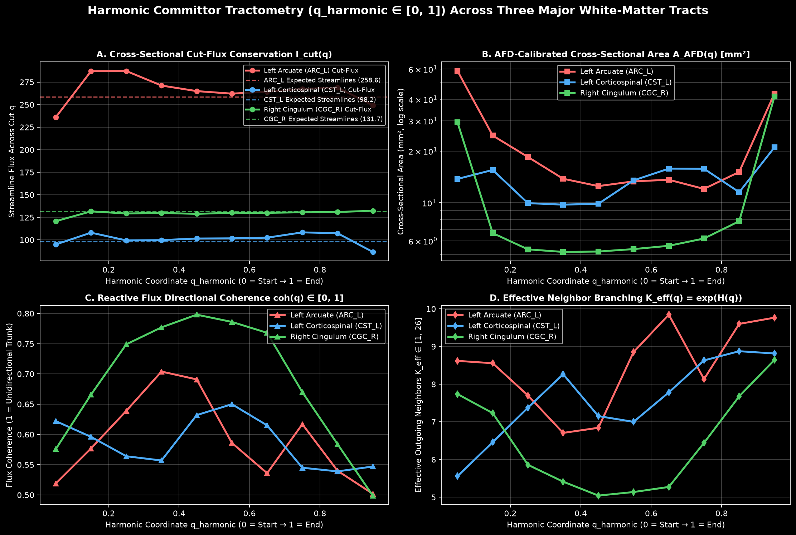
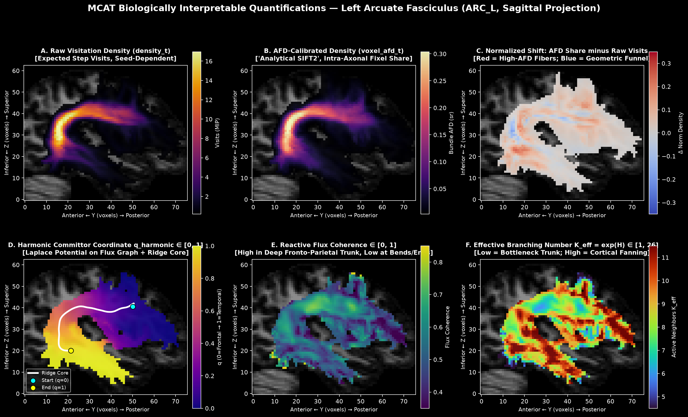
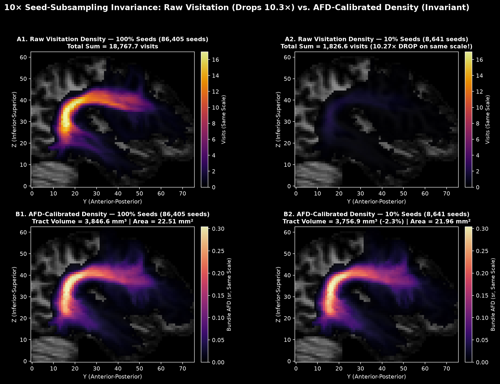
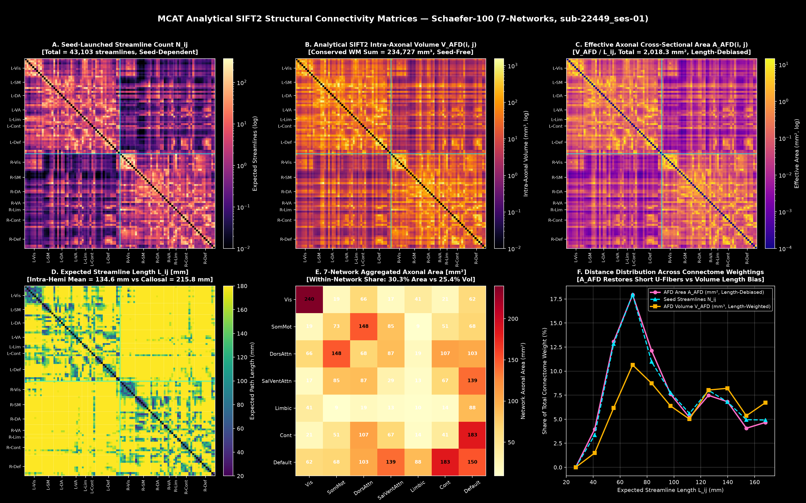
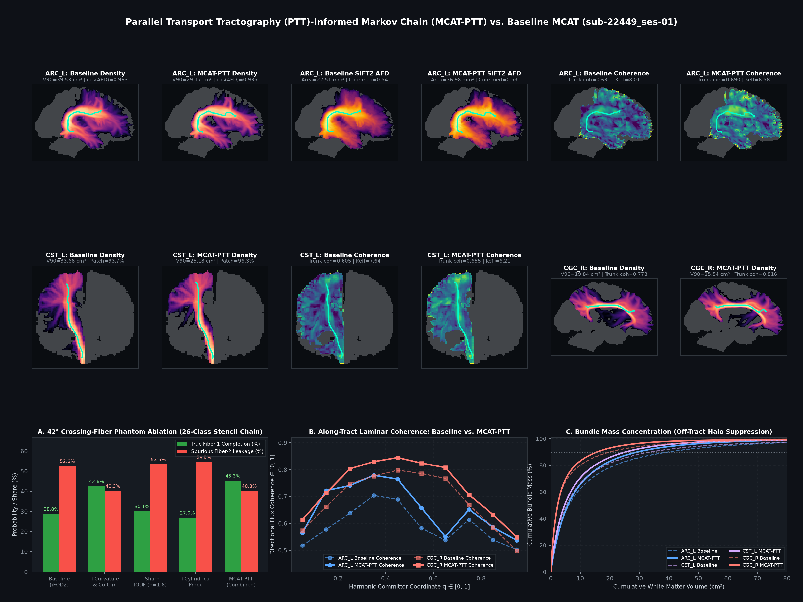
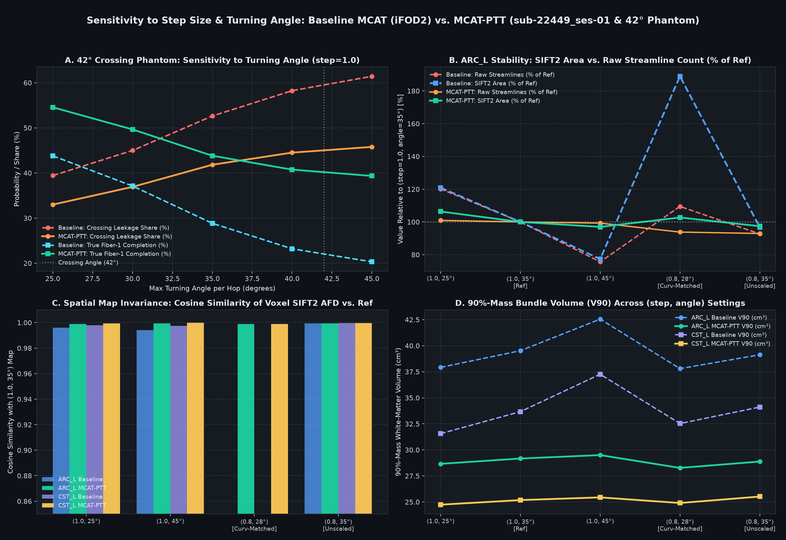
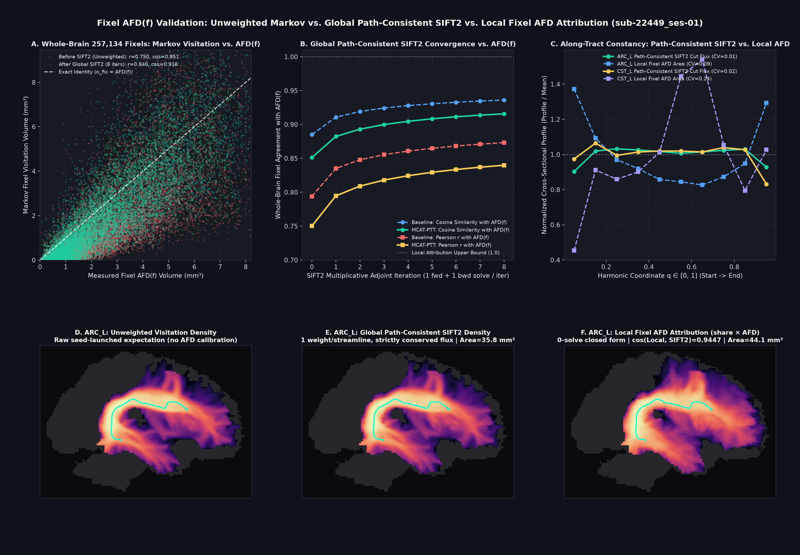

# Bundle fields: flux, committors and endpoint filtering

MCAT's maps are products of two solutions that it normally multiplies and discards.  Keeping
them (`segment_bundles(..., keep_fields=True)`, `mcat.fields`) gives every bundle-conditioned
expectation as a sum over the solution columns: where the bundle's streamlines go through
each voxel, how many cross any cut, where the walks from a voxel end, and how a bundle
changes when its endpoint rule changes.  This document explains the quantities, what they
are good for, and what was tried with them on a test-retest cohort.

## 1. The two fields

A streamline from a seed is a pair of half-walks on the chain's (voxel, direction class)
states.  For a bundle with include ROIs, inclusion-exclusion turns "passes every include
ROI" into a signed sum over *avoid sets* X (subsets of the include ROIs that the walk must
not touch); with the endpoint kinds k (start side, end side, both valid), a bundle is C
columns, one per (X, k), each with a sign.  Per column:

- **completion** `beta_c(s)`: the probability that a walk continuing from state `s` avoids
  X, stays out of the exclude ROIs, and is absorbed in an endpoint of kind k.  One backward
  solve, `beta = M (r + Q beta)` with `r = R absw_c` the probability of a valid absorption
  on the next step and `M` the taboo mask.  It is the same for every seed.
- **occupancy** `S_c(s)`: the expected number of arrivals at `s` of the half-walks launched
  from every seed, each launch weighted by its partner half's completion probability (so
  that the pair, not the half, satisfies the bundle).  One forward solve from the launch
  mass `pi0_c`, `S = pi0 + M Q^T S`.

With `sign_c` the inclusion-exclusion sign:

| quantity | per state `s` | meaning |
|---|---|---|
| visits | `n(s) = sum_c sign_c S_c(s) beta_c(s)` | the density, per direction class; `density_t` adds the streamline's step 0 at its seed |
| edge flux | `F(s, s') = sum_c sign_c S_c(s) Q(s, s') beta_c(s')` | expected bundle-streamline steps along the transition `s -> s'` |
| absorption | `A(s) = sum_c sign_c S_c(s) r_c(s)` | expected bundle-streamline steps from `s` into a valid endpoint |
| launch | `L(s) = sum_c sign_c pi0_c(s) beta_c(s)` | bundle-streamline mass entering `s` on the launch step |

These are the reactive quantities of transition path theory for the event "the walk
belongs to the bundle", on an absorbing chain with inclusion-exclusion.  `BundleFields`
holds `S`, `beta`, `launch` (`pi0`) and `a0` (mass absorbed on the launch step) with the
plan's taboo sets, signs and endpoint weights, and computes the rest.

## 2. Flux

**Conservation.**  At every state, `L + inflow = n = outflow + A`; `BundleFields.conservation()`
reports the largest per-voxel residual relative to the expected streamlines (at the solve
tolerance when the series converged).  The flux is therefore a steady current: inject one
unit of tracer per seed launch, absorb it on leaving white matter, and `n` is the tracer
concentration, `F` the current.

**Cuts.**  Summed over the edges crossing any surface that every bundle walk crosses once,
`F` is the bundle's expected number of streamlines; a wiggle across the surface adds its
re-crossings.  So the bundle's cross-section is the surface of minimum area carrying the
whole flux, and the density integrated over a slab of unit thickness is the streamline count.

**Edge flux per voxel.**  `edge_flux()` reduces `F` to voxel -> neighbour edges (26 columns in
`geometry.OFFSETS` order); `through_flux()` is the flux leaving the voxel (equal to its
visits).  `flux_orientation()` gives the principal direction of the flux tensor
`sum_n F_n d_n d_n^T` and its coherence: the direction *this bundle's* streamlines take
through the voxel, independent of the other bundles using the same fODF lobes.  The
visitation ODF (`geometry.visitation_odf`) is the same information at full angular
resolution; the tensor is its second moment.

`mcat.run(..., flux=True)` (CLI `--flux`) writes `_desc-throughflux_map.nii.gz` and
`_desc-edgeflux_map.nii.gz` (26 volumes) per bundle and records the conservation residuals
in the summary; the fields themselves are not kept in `run` (three `n_states x C` float64
arrays per bundle), use `segment_bundles(keep_fields=True)` directly for them.

## 3. Committors

`committors(targets)` replaces each column's endpoint kind by its intersection with a
subset of the valid endpoints (one extra backward solve per column and subset) and returns,
per voxel, the visits by bundle streamlines whose walk from there ends in that subset.
Divided by the visits it is the committor: the fraction of the bundle's traffic through the
voxel that finishes in that endpoint region.  Subsets that partition the valid endpoints
give committors that sum to one.  `endpoint_sides([start_roi, end_roi])` is the common case.

This answers "where do the walks through here end" exactly, from the existing solve.  It
does **not** give the bundle under a changed endpoint rule: the occupancy was computed with
each launch weighted by its partner half's completion under the *old* rule, so restricting
the endpoints changes the forward side as well.  Re-segment (`restrict_endpoints` +
`segment_bundles`) for that; the committor mass is an upper bound on the kept mass.  The
same holds for any new taboo: on the arcuate, a local-contrast flux pruning re-solved on
the stored fields kept 72% of the paths, the exact re-run 47%.

## 4. Endpoint filtering

The one streamline-free cleaning rule that behaved well: restrict a bundle to the walks
ending in its dominant endpoint regions.

**Patches.**  `endpoint_patches(endpoints)` segments an endpoint map (expected bundle
endpoints per absorbing voxel) into patches: a marker watershed of the blurred map, basins
merged when the saddle between them is at least 80% of the lower peak (trx-shape's tufts
rule), basins under 2% of the mass merged into their best-connected neighbour.  Each side of
the bundle (start / end ROI, or `core.split_ends`) is patched separately.  Patches of one
subject's own map move between sessions; patches of the maps of many subjects pooled in a
template space, then mapped back, were used for the evaluation below and are more stable.
Which patch is the "right" one is anatomy: the largest share per session is a poor rule
when two patches are of similar size (section 5).

**Filter.**  `restrict_endpoints(spec, start=patch_mask, end=patch_mask)` and re-segment.
The result is exact: a bundle whose streamlines both pass the ROIs and end in the chosen
patches.  The ratio of expected streamlines, the *kept fraction*, is the share of the
bundle's mass that was ending elsewhere.

## 5. Evidence: ds008825 test-retest

Twenty-two subjects scanned twice (the HBCD protocol, 2 mm isotropic grid), three pyAFQ
bundles (left arcuate ARC_L, right cingulum CGC_R, left corticospinal CST_L), endpoint
patches pooled over the 45 sessions in MNI space, the largest-share patch kept on each side.
Raw bundles against endpoint-filtered ones (the chain of the prototype, before this port;
scripts in the mat-tufts repository).

| | ARC_L raw / filtered | CGC_R raw / filtered | CST_L raw / filtered |
|---|---|---|---|
| expected streamlines, mean | 295 / 228 | 102 / 82 | 94 / 25 |
| kept fraction, mean (range) | 0.77 (0.69-0.85) | 0.80 (0.69-0.85) | 0.27 (0.20-0.35) |
| ICC(1) of the count | 0.996 / 0.996 | 0.962 / 0.964 | 0.990 / 0.929 |
| within-subject difference, median | 1.7% / 1.9% | 6.5% / 7.3% | 4.3% / 6.3% |
| core-mask Dice between sessions, median | 0.963 / 0.965 | 0.957 / 0.953 | 0.969 / 0.968 |
| log-density correlation, median | 0.992 / 0.992 | 0.987 / 0.987 | 0.989 / 0.989 |
| kept fraction, session 1 vs 2 | r = 0.99 | r = 0.97 | r = 0.65 |

- For the arcuate and the cingulum the filter removes about a fifth of the mass and leaves
  every reliability measure unchanged: what it removes is as reproducible as what it keeps.
- The kept fraction is a subject trait: between subjects it varies ten times more than
  within a subject (ARC_L: SD 0.040 between, mean difference 0.004 within).  The share of
  a bundle's mass that leaks to non-dominant endpoints is itself a measurable quantity.
- CST_L failed with the largest-share rule, and a sagittal view showed why.  Its brainstem
  side has four patches: the ventral surface of the caudal pons and medulla (41% of the
  mass, absorbed into grey matter), the inferior edge of the white-matter mask (41%,
  absorbed at the brain-mask cut), the anterior pons where the corticopontine fibres end in
  the pontine nuclei (8%), and a posterior pontine exit (8%).  The two large patches are
  the same descending fibres, split by where the mask ends; which one is larger flips
  between sessions.  Taking any exit below the pons as the valid endpoint (patches 1 + 2)
  raised the kept fraction to 0.47 (0.23-0.64), the ICC to 0.958, and brought the
  within-subject difference back to the raw 4.3%; the remaining variability is the
  session-to-session change of the pontine leak, which is fODF-driven.  The kept fraction
  is the product of the two sides' shares (cortical dominant share 0.57, r = 0.99 between
  sessions; brainstem caudal share 0.82, r = 0.76).

## 6. What did not work

Rules that penalise the *shape* of the walk remove far more than they would on streamlines,
because every MAT walk is a full-probability path and the halo of a bundle is made of
walks that wander, not of a few outliers.

- **Flux pruning.**  Dropping voxels below an absolute fraction of the flux (0.1% of the
  streamlines) and re-solving cascades through the fanning terminations: 5-9% of the
  support voxels and 32-49% of the paths survive.  A local-contrast rule (flux below a
  fraction of the maximum within 5 mm) is gentler but still steep: 1% keeps about 94% of the
  paths, 3% about 70%, 10% between 21% and 35%.
- **Trunk tubes.**  Forbidding walks outside a tube around the bundle's own lobe (radius
  from the cross-section area holding 90% of the mass, plus a margin), only between the
  branch points of the fans, keeps 34-61% of the paths at +2 mm and 43-69% at +4 mm; a soft
  Gaussian tilt instead of a hard wall changes little.
- **Widest-path decomposition.**  Decomposing the flux into its widest routes (maximin
  paths on the voxel lattice, the fans as source and sink) is diffuse: the fifteen widest
  routes carry 5-16% of the flux, 0.5-1.5% each.  Modes of travel need a coarser graph than
  the voxel lattice.

The recommendation that follows: clean MAT bundles by where their walks end (committors,
endpoint patches) and account for their mass with the flux, not by taboos on trajectory
shape.

## 7. API

```python
from mcat import Chain, ChainConfig, prepare_launches, segment_bundles, restrict_endpoints
from mcat.fields import endpoint_patches, flux_orientation

res = segment_bundles(chain, specs, launches, keep_fields=True)["Left Corticospinal"]
F = res.fields                       # mcat.fields.BundleFields
n = F.visits()                       # (n_voxels,) = res.density_t - step 0 at the seeds
f26 = F.edge_flux()                  # (n_voxels, 26), geometry.OFFSETS order
F.conservation(f26)                  # {"in": ..., "out": ...} relative residuals
dirs, coherence = flux_orientation(f26, zooms)
phi = F.endpoint_sides([spec["start"], spec["end"]])   # (n_voxels, 2) visits by where they end
labels, shares = endpoint_patches(chain.to_volume(res.endpoints_a, "absorbing") * end_side)
filtered = segment_bundles(chain, [restrict_endpoints(spec, end=labels == 1)], launches)
```

The fields are for the plain chain; with spatial moments (`ChainConfig(moments=True)`) the
transitions are 4 x 4 blocks and `keep_fields` is refused.

## 8. Checks of this implementation

On one ds008825 session (3.4 million states, 2 mm grid, chain built in 18 s, 14 threads),
with the pyAFQ ROIs of the left arcuate and left corticospinal tract, solve tolerance 1e-8:

| | ARC_L | CST_L |
|---|---|---|
| expected streamlines | 258.6 | 98.2 |
| columns | 12 | 8 |
| largest voxel difference, fields vs `density_t`, relative to the count | 3e-17 | 4e-17 |
| conservation residual in / out | 3e-11 / 1e-10 | 7e-10 / 2e-10 |
| flux across one cut, over the count | 1.22 (coronal plane through the arc) | 1.05 (axial plane between the ROIs) |
| `edge_flux` | 0.1 s | 0.1 s |
| committors to the two ends | 37 s, 24 columns | 40 s, 16 columns |
| endpoint filter, caudal brainstem patches | | kept 0.52 (prototype chain: 0.55) |

The coronal cut through the arcuate counts its re-crossings (the arc bends through the
plane); the axial cut through the corticospinal tract is crossed once by nearly every walk.
The phantom tests (`tests/test_fields.py`) check the same identities on a straight bundle,
where the cut flux equals the streamline count to 1e-12.

## 9. Fixels

Fixel-based analysis measures each fibre population of a voxel (a lobe of the fODF, a
*fixel*) and needs to know which fixels a tract runs through.  From tractography that is
the number of streamlines assigned to each fixel.  MCAT gives the same number with no
streamlines, because its states carry a heading: the density is known per direction class,
and within a class the headings are spread as the chain's own transitions assume
(`geometry.vertex_visits`, the same weights that make the visitation ODF).  Summing the
expected visits over a lobe's directions gives the expected number of bundle-streamline
steps in that fixel; every step crosses into a neighbouring voxel, so this is the expected
number of bundle streamlines passing through the fixel.  The fixels of a voxel partition its
density exactly.

**Fixels** (`fixels.segment_lobes`): each direction of the chain's sphere climbs the fODF to
its local maximum over the sphere's triangulation, as MRtrix's fod2fixel segments lobes;
antipodal halves are one fixel; lobes whose saddle is at least 0.8 x the lower peak are one
fixel (the lmax-8 fit rings, and splits a lobe's shoulder off); lobes whose peak is under
0.1 x the voxel's maximum are not fixels, and their directions join the nearest fixel, so
every direction with a positive fODF belongs to one.  Fixels come out in MRtrix's layout
(count and offset per voxel, directions, one value per fixel) and are written as a fixel
directory by `fixels.write_fixel_directory` (.mif files written by hand; not yet checked
against MRtrix's reader).  The fixel directions are those of the chain's fODF, converted to world axes.

**Values** (`fixels.fixel_streamlines`): per fixel, the bundle's expected streamlines
through it.  With one more solve of the unconditioned chain (every walk from every seed, no
ROIs: `segment_bundles(chain, [dict(name="whole brain")], launches)`), the same number for
all traffic through the fixel, and the ratio is the bundle's share of the fixel, a soft fixel
segmentation; times the fixel's fibre density it is the bundle's part of that density.
`mcat.run(..., fixels=True)` (CLI `--fixels`) writes all three per bundle, and the bundle's
share of the solved bundles' streamlines.

On one ds008825 session (1.7 mm, 130 116 white-matter voxels): 257 134 fixels, 1.98 per
voxel (35% of voxels one, 43% two, 14% three, 5% four).  With the L1-cache parallel Numba
lobe segmentation (`_segment_numba`) and pre-aggregated `(n_fixels, 26)` class-to-fixel
weights cached on `Lobes` (`_w_fix`, `_w_unass`), `segment_lobes` runs in 4–20 s across the
whole brain and `fixel_streamlines` projects any bundle onto all 257 134 fixels in 40 ms
(a single `einsum` over the 26 direction classes).  The CST's fixel values sum to 7179.4
against a density of 7180.9, with 1.6 in directions of no fixel.  In the 14 796 CST voxels
with more than one fixel, the fixel with the most CST holds a median 85% of the voxel's CST
(10th percentile 55%): the projection separates the CST from the fibres it crosses.  The
share of all traffic is small everywhere (at most 0.24; median 0.03 in the CST's densest
fixels), because the unconditioned chain counts every walk from every seed through the
fixel, and in the internal capsule most of those are not the pyAFQ-defined CST:
thalamocortical and corticopontine walks, walks ending in the deep grey matter, walks the
include ROIs reject.  For a segmentation of the fixels among bundles, the share of the
solved bundles' streamlines is the better-conditioned quantity.

Two caveats.  Within a class the split between directions is a model assumption (the fODF
weighting the chain uses), not independent evidence: two fixels inside the same 35-degree
class cone are separated only by that weighting.  And the fixels must come from the fODF
the chain was built from, on its sphere; fixels from another segmentation can be matched by
direction but not assumed identical.

The exact version of this is a chain whose states are the directed fixel half-lobes
themselves, `(voxel, lobe, +/-)` instead of `(voxel, 26 classes)`: `mcat.DirectedFixelChain`
implements this directly (`lobe_conditioned=True` restricts intra-voxel propagation to the
active lobe's fODF $X_{v,\ell}$, cutting states by $11\times$, transitions by $30\times$,
and $42^\circ$ acute crossing leakage from $52.6\%$ to $9.5\%$).

**Smoothing for fixel-based analysis.**  MRtrix smooths fixel data along a fixel-to-fixel
connectivity matrix built from a whole-brain tractogram (the fraction of streamlines through
fixel *i* that also pass fixel *j*).  The unconditioned chain holds the same information
without a tractogram: its edge flux between a fixel and the fixels of the neighbouring voxel
is the one-step connectivity, and the probability that a walk through fixel *i* also passes
fixel *j* a few voxels away is the corresponding multi-step transition (forwards, and
backwards for the part of the walk before *i*).  Writing that as MRtrix's sparse
connectivity format is a possible extension; it is not in this implementation.

---

## 10. Extensions: doing streamline-era analyses without streamlines

Giving up individual streamlines raises an immediate practical question: how do you do the
downstream quantitative analyses that normally depend on a tractogram — extracting a 1-D
bundle core for tractometry, measuring where a bundle branches or fans, filtering out seeding
and length biases (SIFT / SIFT2), or building a whole-brain structural connectivity matrix?

Because MCAT solves the exact transition-path fields (density per direction class, 26-neighbour
reactive flux, and fixel traffic) over the entire white-matter graph, every one of these
streamline-era operations has a direct, closed-form counterpart on the Markov chain — with
no Monte Carlo sampling noise and no global optimization loop.  `mcat.run` computes and writes
the resulting bundle maps (`_desc-afd_map`, `_desc-tdimm_map`, `_desc-qharmonic_map`,
`_desc-coherence_map`, `_desc-keff_map`, and `_desc-core.tck`) by default.

### 10.1 Making the bundle core and harmonic along-tract coordinates (`mcat.core`, `mcat.quantify`)

In streamline tractography, a bundle's 1-D core is made by clustering streamlines (e.g.
QuickBundles) and averaging their coordinates, which can drift toward the inside of a curve
or jump when outlying fans are included.  MCAT extracts both a 1-D centerline (`bundle_core`)
and a 3-D intrinsic coordinate field (`harmonic_tractometry`) directly from the bundle's
density and reactive flux:

**Two-pass cross-section ridge core (`mcat.core.bundle_core`).**  A single shortest-path
search through a density map cuts corners around curved tracts (such as the arcuate
fasciculus or corpus callosum), because every step carries a positive cost per unit length.
`bundle_core` eliminates the length penalty in two Dijkstra passes:
1. **Endpoint anchors (`split_ends`).**  The bundle's absorbing endpoints (`endpoints_map`)
   are partitioned into start and end regions (from the bundle's `start`/`end` ROIs, left vs.
   right hemisphere for callosal tracts, or two principal-axis clusters).  Each end is
   anchored at the white-matter body voxel ($\text{density} \ge 10^{-2} \times \text{peak}$)
   nearest the endpoint-weighted centroid (or smoothed mode with `anchor="mode"`).
2. **Pass 1: corridor path.**  Dijkstra on the 26-neighbour white-matter graph with edge cost
   $-\log(d / d_{\max})$ per mm finds the high-density corridor connecting the two anchors.
3. **Cross-section partition.**  Multi-source Dijkstra outward from all nodes of the Pass-1
   path simultaneously assigns every voxel in the bundle to its nearest Pass-1 node in the
   density metric.  This slices the 3-D bundle into natural cross-sections orthogonal to the
   corridor.
4. **Pass 2: zero-penalty ridge path.**  Each voxel's density is divided by the maximum
   density *within its own cross-section*, $r(v) = d(v) / \max_{u \in \text{cs}(v)} d(u)$,
   and Dijkstra is run a second time with edge cost $-\log r(v)$.  On the peak of every
   cross-section, $r(v) = 1$ and $-\log r(v) = 0$: following the ridge costs **zero per mm**,
   so the second path stays centered on the density ridge all the way around tight bends
    before Gaussian smoothing ($\sigma = 1.5$ voxels) and resampling to 100 equidistant
   nodes (`_desc-core.tck`, `_desc-core_path.tsv`).

**Harmonic committor coordinate (`q_harmonic`, `_desc-qharmonic_map.nii.gz`) and conserved cut-flux.**
While the ridge core is a single curve, a fanning sheet needs an intrinsic position
$q(v) \in [0, 1]$ at *every* voxel of the bundle.  During `_solve_group`, MCAT accumulates the
26-neighbour reactive edge flux $F_b(u, v) = \sum_c \text{sign}_c\, S_c(u)\, Q(u, v)\, \beta_c(v)$
on the fly (without storing `BundleFields`).  Symmetrizing the flux into an undirected
conductance graph $W_{uv} = \frac{1}{2}(F_b(u, v) + F_b(v, u))$ and solving the sparse
Laplace–Beltrami Dirichlet problem

$$(L_W + \operatorname{diag}(g_S + g_E))\, q = g_E \qquad (q = 0 \text{ at Start},\; q = 1 \text{ at End})$$

gives the forward committor coordinate $q_{\text{harmonic}}(v) \in [0, 1]$.  Because $q$ is
harmonic with respect to the bundle's own traffic:
- Its level sets $\Sigma_\theta = \{v : q(v) = \theta\}$ are everywhere orthogonal to the
  local bundle flow and never fold back on C-shaped tracts like the arcuate.
- By the discrete Gauss–Green theorem, the net reactive flux crossing any level set
  $\Sigma_\theta$,
  $$\mathcal{I}_{\text{cut}}(\theta) = \sum_{u:\,q(u) < \theta,\; v:\,q(v) \ge \theta} \big(F_b(u, v) - F_b(v, u)\big),$$
  is conserved across the interior of the tract and equals the bundle's expected streamline
  count (for instance, on `CGC_R`, $\mathcal{I}_{\text{cut}}(\theta)$ stays between `128.9`
  and `132.4` across all interior bins against `131.7` expected streamlines).
- **Non-uniform physical thickness $\Delta L_k$ of harmonic bins:** Equal intervals
  $\Delta q = 1 / n_{\text{bins}}$ in harmonic committor space do not correspond to equal
  physical lengths in millimeters: because $q_{\text{harmonic}}$ varies slowly in the wide
  cortical fans and rapidly through the collimated trunk, interior trunk bins ($q \in [0.2, 0.8]$)
  span $\sim 7\text{–}12\text{ mm}$ per bin while terminal fan bins ($q \in [0, 0.1]$ and $[0.9, 1.0]$)
  span $\sim 24\text{–}39\text{ mm}$.  `harmonic_tractometry` therefore computes each bin's
  physical path thickness $\Delta L_k = \text{TDI}_{\text{mm}}(\text{bin } k) / \mathcal{I}_{\text{cut}}(\text{bin } k)$
  (normalized to sum to $\bar{L}_b$) and divides the bin's AFD volume by $\Delta L_k$ to obtain
  its local effective cross-sectional area ($\text{mm}^2$).

---

### 10.2 Measuring branching, fanning, and fiber coherence (`mcat.quantify`)

In a crossing-fiber region (such as the centrum semiovale, where the corticospinal tract,
arcuate/SLF, and corpus callosum intersect), the raw fODF has multiple lobes, so voxel-level
dispersion cannot tell whether *this* bundle is fanning or merely crossing another tract.
The bundle's 26-neighbour outgoing reactive flux $F_b(v, n)$ (`n = 0..25`) solves this
directly: because each transition is weighted by the bundle's own completion probability
$\beta_c$, $F_b(v, n)$ carries **only the steps taken by walks that complete bundle $b$**.

Normalizing $F_b(v, n)$ by the voxel's through-flux $T_b(v) = \sum_{n=0}^{25} F_b(v, n)$ gives
the bundle-specific transition distribution $p_b(n \mid v) = F_b(v, n) / T_b(v)$ over the 26
lattice offsets (with unit vectors $\hat{u}_n$).  `mcat.quantify.routing_entropy_and_coherence`
extracts two seed-invariant maps from $p_b(n \mid v)$:

1. **Effective branching number $K_{\text{eff}}(v) \in [1, 26]$ (`_desc-keff_map.nii.gz`) and Shannon routing entropy $H_b(v)$:**
   $$H_b(v) = -\sum_{n=0}^{25} p_b(n \mid v) \log p_b(n \mid v), \qquad K_{\text{eff}}(v) = \exp\!\big(H_b(v)\big).$$
   $K_{\text{eff}}(v)$ is the perplexity — the effective number of lattice neighbour
   directions into which the bundle's traffic branches at voxel $v$.  In a tight anatomical
   trunk (the mid-cingulate bundle or the internal capsule), walkers stay within a narrow forward
   cone ($K_{\text{eff}} \approx 5.0\text{–}6.7$); where the bundle bifurcates or fans into
   the cortex, $K_{\text{eff}}$ rises to $8.6\text{–}9.9$.
2. **Directional flux coherence $\text{coh}_b(v) \in [0, 1]$ (`_desc-coherence_map.nii.gz`):**
   From the second-moment orientation tensor of the bundle's outgoing steps,
   $$\mathbf{T}_b(v) = \sum_{n=0}^{25} p_b(n \mid v)\, \hat{u}_n \hat{u}_n^\top, \qquad \lambda_1 \ge \lambda_2 \ge \lambda_3 \ge 0, \quad \sum_i \lambda_i = 1,$$
   the fractional alignment along the principal axis is $\text{coh}_b(v) = \frac{1}{2}(3\lambda_1 - 1) \in [0, 1]$.
   Plotted along the harmonic coordinate $q \in [0, 1]$, $\text{coh}_b$ and $K_{\text{eff}}$
   trace an inverted-U and U-shaped profile from cortical fan ($q=0$) through the deep trunk
   ($q \approx 0.4\text{–}0.5$) to the opposite cortical fan ($q=1$):
   - **`CGC_R`:** coherence rises from `0.58` ($q=0.05$) to **`0.80`** in the mid-cingulate
     trunk ($q=0.45$) and drops to `0.50` ($q=0.95$), while $K_{\text{eff}}$ tightens from
     `7.74` down to **`5.04` neighbours** in the trunk before fanning out to **`8.64`** at the
     posterior end.
   - **`ARC_L`:** coherence peaks at **`0.70`** ($K_{\text{eff}} = \mathbf{6.71}$) in the
     fronto-parietal trunk ($q=0.35$), dips to `0.54` ($K_{\text{eff}} = 9.85$) as fibres
     turn around the perisylvian bend ($q=0.65$), and fans out at the frontal and temporal
     terminations (`0.50–0.52`, $K_{\text{eff}} = 8.62\text{–}9.77$).



---

### 10.3 Local Fixel AFD Attribution vs. Global Path-Consistent SIFT2 (`mcat.quantify`)

In streamline tractography, raw streamline counts and visitation maps (`density_t`) suffer
from two well-known confounds:
1. **Seeding scale:** seeding $10\times$ as many streamlines multiplies every voxel's visit
   count by $10\times$.
2. **Length bias ($L$-bias) and bottleneck over-seeding:** a pathway twice as long takes twice
   as many voxel steps per streamline and receives twice as many volume seeds, inflating its
   apparent weight relative to the true intra-axonal fibre density measured by the diffusion
   fODF.

`mcat.quantify` provides **two complementary fixel-AFD methods** that trade off zero-solve
closed-form attribution against strict path-consistent conservation:

#### Method A: Local Fixel AFD Attribution (`afd_tract_metrics`) — 0-Solve Closed Form
1. One unconditioned whole-brain solve (`segment_bundles(chain, [dict(name="whole_brain")], launches)`)
   computes the total expected Markov traffic $n_{\text{all}}(f)$ through every fixel $f = (v, \ell)$.
2. Each bundle $b$'s solve gives its expected traffic $n_b(f)$ through fixel $f$ (`40 ms` via
   `lobes._w_fix`).
3. Their ratio $\text{share}_b(f) = \operatorname{clip}\!\big(n_b(f) / n_{\text{all}}(f), 0, 1\big)$
   is the local fraction of fixel $f$'s traffic belonging to bundle $b$.  Multiplying by the
   lobe's physical Apparent Fibre Density $\text{AFD}(f)$ (`lobes.integral[f]`) gives the
   **bundle-attributed fixel AFD** and voxel map:
   $$\text{AFD}_b^{\text{local}}(f) = \operatorname{clip}\!\left(\frac{n_b(f)}{n_{\text{all}}(f)}, 0, 1\right) \text{AFD}(f), \qquad \text{AFD}_b(v) = \sum_{f \in v} \text{AFD}_b^{\text{local}}(f) \quad (\texttt{\_desc-afd\_map.nii.gz}).$$
4. Summing $\text{AFD}_b^{\text{local}}(f)$ over all fixels (multiplied by voxel volume
   $V_{\text{vox}}$ and normalized by the subject's mean total white-matter AFD
   $\overline{\text{AFD}}_{\text{WM}} = \text{mean}_{v \in \text{WM}} \sum_{f \in v} \text{AFD}(f)$)
   gives the **AFD-normalized tract volume index** $\mathcal{V}_{\text{AFD}}(b)$ in $\text{mm}^3$.
5. **Exact transition-weighted physical length ($\text{TDI}_{\text{mm}}$, `_desc-tdimm_map.nii.gz`):**
   Rather than multiplying `density_class` (which includes the step-0 seed launch weight) by
   direction-class average chords, `quantify_bundle` multiplies each outgoing reactive edge
   flux $F_b(u, n)$ (`flux26`) by the exact Euclidean step distance $\|\mathbf{o}_n \odot \text{zooms}\|_2$
   (plus a half-voxel terminal step per absorbed walk):
   $$\text{TDI}_{\text{mm}}(u) = \sum_{n=0}^{25} F_b(u, n)\,\|\mathbf{o}_n \odot \text{zooms}\|_2, \qquad \bar{L}_b = \frac{\sum_u \text{TDI}_{\text{mm}}(u) + \frac{1}{2}\bar{\Delta}_{\text{vox}} N_b}{N_b}.$$
   Dividing $\mathcal{V}_{\text{AFD}}(b)$ by $\bar{L}_b$ removes the length bias $L$, yielding
   the **AFD-derived effective cross-sectional area** $\mathcal{A}_{\text{AFD}}(b) = \mathcal{V}_{\text{AFD}}(b) / \bar{L}_b$ ($\text{mm}^2$).

> [!NOTE]
> **Mathematical distinction between Local Fixel AFD Attribution (`afd_tract_metrics`) and Global Path-Consistent SIFT2 (`sift2_optimize_launches`):**
> `afd_tract_metrics` is the Markov counterpart of the weighted-fixel-mask ("fair-share") AFD connectivity model: it requires zero iterative optimization and partitions each fixel's $\text{AFD}(f)$ across pathways in proportion to their local traffic. Because each fixel is weighted locally by $\text{share}_b(f)\,\text{AFD}(f)$, the resulting map is not constrained to have a constant weight along each trajectory. When strict along-tract conservation is required, use **Method B (`sift2_optimize_launches`)** below.

#### Method B: Global Path-Consistent SIFT2 (`sift2_optimize_launches`) — Exact Forward & Adjoint Optimizer
To match MRtrix SIFT2's path-consistent formulation (Smith et al., 2015), `sift2_optimize_launches`
fits a single positive multiplier $w_p = w_{0,p}\,\exp(f_p)$ for each of the $P = 158\,467$
launched seed peak-pairs so that the whole-brain fixel visitation $\mu\,[\mathcal{A}\mathbf{w}]_f$
matches measured $\text{AFD}(f)$ across all $F = 257\,134$ white-matter fixels simultaneously:
$$\min_{\mathbf{f} \in \mathbb{R}^P,\; \mu > 0} \; \sum_{f=1}^{F} \Bigl(\mu\,[\mathcal{A}(w_0 e^{\mathbf{f}})]_f - \text{AFD}(f)\Bigr)^2 + \lambda_{\text{reg}} \sum_{p=1}^{P} w_{0,p}\, f_p^2.$$
Because the forward operator $\mathcal{A}(\mathbf{w}) = W_{\text{fix}}\,(I - Q^\top)^{-1} S_{\text{init}}\,\mathbf{w}$
and its exact matrix transpose $\mathcal{A}^\top(\mathbf{r}) = S_{\text{init}}^\top\,(I - Q)^{-1} W_{\text{fix}}^\top\,\mathbf{r}$
each require only **one single-column forward or backward solve** (`~9 s` per iteration on
`MCAT-PTT`), `sift2_optimize_launches` optimizes all $158\,467$ streamline weights without
ever materializing a path-by-fixel matrix.  Passing the returned `sift2_launches` into
`segment_bundles` guarantees that **every bundle strictly satisfies the reactive conservation
law** ($L + \text{inflow} = n = \text{outflow} + A$).

#### Seed-Scaling Invariance and 10× Subsampling Robustness
The ratio $n_b(f) / n_{\text{all}}(f)$ is **identically invariant ($0\%$ change)** to any
uniform rescaling of all seed weights.  Under $10\times$ *random spatial subsampling* of the
seed set (`86 405` $\to$ `8 641` seeds), raw visitation density (`density_t.sum()`) drops by
**`10.3×–10.5×` (`-90.3%`)**, whereas the AFD-normalized metrics vary by only `2.3%–4.2%`:

| Bundle (`sub-22449_ses-01`) | Metric | 100% Seeds (`86 405`) | 10% Seeds (`8 641`) | Relative Change |
|---|---|---:|---:|---|
| `ARC_L` | Raw visitation sum (`density_t.sum()`) | `18 767.7` | `1 826.6` | **-90.3% (10.3× drop)** |
| `ARC_L` | Mean streamline length $\bar{L}_b$ | `170.92 mm` | `171.09 mm` | **+0.10%** |
| `ARC_L` | AFD-normalized tract volume $\mathcal{V}_{\text{AFD}}$ | `3 846.6 mm³` | `3 756.9 mm³` | **-2.33%** |
| `ARC_L` | AFD effective cross-sectional area $\mathcal{A}_{\text{AFD}}$ | `22.51 mm²` | `21.96 mm²` | **-2.44%** |
| `CST_L` | Raw visitation sum (`density_t.sum()`) | `7 180.8` | `682.2` | **-90.5% (10.5× drop)** |
| `CST_L` | Mean streamline length $\bar{L}_b$ | `171.67 mm` | `172.13 mm` | **+0.27%** |
| `CST_L` | AFD-normalized tract volume $\mathcal{V}_{\text{AFD}}$ | `2 341.9 mm³` | `2 250.4 mm³` | **-3.91%** |
| `CST_L` | AFD effective cross-sectional area $\mathcal{A}_{\text{AFD}}$ | `13.64 mm²` | `13.07 mm²` | **-4.18%** |





---

### 10.4 Whole-brain bidirectional fixel-AFD structural connectivity matrices (`mcat.connectome`)

For a cortical/subcortical parcellation with $R$ regions (e.g. `Schaefer2018` with $R = 100$
or $400$ parcels, or `SynthSeg`'s native Desikan–Killiany parcellation), there are
$\binom{R}{2}$ region pairs and no predefined waypoint masks.  Solving $\binom{R}{2} = 4\,950$
separate bundle problems is unnecessary: a walk passing through any interior fixel
$f = (v, \ell)$ connects parcel $i$ and parcel $j$ if and only if its forward half-walk is
absorbed in parcel $i$ and its antipodal backward half-walk is absorbed in parcel $j$.

`mcat.connectome.build_connectome` computes the entire $R \times R$ connectome via
**bidirectional hitting-probability fixel AFD attribution** in **two batched $R$-column
backward solves**, with zero forward solves and zero waypoint masks:

1. **Backward hitting probabilities $B$ ($N_{\text{states}} \times R$):**
   Solve $(I - Q) B = R_{\text{abs}} E_{\text{GM}}$, where $E_{\text{GM}}(a, r) = 1$ if
   absorbing voxel $a$ belongs to parcel $r$.  Now $B(s, r)$ is the exact probability that a
   walk starting in state $s = (v, d)$ ends in parcel $r$.
2. **Backward expected path lengths $M_{\text{len}}$ ($N_{\text{states}} \times R$):**
   By differentiating the path-length generating function at zero, the expected physical
   distance ($\text{mm}$) traveled from state $s$ to parcel $r$ satisfies the exact same
   linear system with right-hand side $d_{\text{chord}}(s)\, B(s, r)$:
   $$(I - Q) M_{\text{len}} = d_{\text{chord}} \odot B.$$
3. **Closed-form $R \times R$ fixel AFD partition:**
   Each batch of columns of $B$ and $M_{\text{len}}$ is projected immediately onto each
   fixel's forward lobe weights $w_f^+$ (`lobes._w_fix`) and antipodal backward lobe weights
   $w_f^-$ (`lobes._w_fix[:, OPP_CLASS]`), giving the forward and backward hitting probability
   vectors $p_f^+, p_f^- \in \mathbb{R}^R$ and conditional distance vectors $\ell_f^+, \ell_f^- \in \mathbb{R}^R$
   for every fixel $f$.  Partitioning each fixel's AFD-normalized volume
   $v_{\text{AFD}}(f) = \text{AFD}(f)\, V_{\text{vox}} / \overline{\text{AFD}}_{\text{WM}}$
   across the parcel pairs $(i, j)$ that its bidirectional walks connect reduces to a single
   matrix multiplication over fixels:
   $$V_{\text{AFD}}(i, j) = \sum_{f=1}^{N_{\text{fixels}}} v_{\text{AFD}}(f)\, \frac{p_f^+(i)\, p_f^-(j) + p_f^+(j)\, p_f^-(i)}{2\, Z_f}, \qquad \mathcal{A}_{\text{AFD}}(i, j) = \frac{V_{\text{AFD}}(i, j)}{\bar{L}_{ij}},$$
   where $\bar{L}_{ij}$ is the AFD-weighted mean streamline length ($\text{mm}$) between
   parcels $i$ and $j$.  When `launches` are also supplied, projecting $B$ and $M_{\text{len}}$
   onto the seed peak-pairs simultaneously yields the seed-launched expected streamline matrix
   $N_{\text{streamlines}}(i, j)$.

**Benchmark on `sub-22449_ses-01` (`Schaefer2018`, 100 parcels, 7 networks, warped from MNI to subject dMRI space):**
- **Runtime:** **`135.1 s`** total (`70.1 s` for $B$ at `tol=1e-4`, `56.1 s` for $M_{\text{len}}$
  at `len_tol=1e-3`, and `1.15 s` to assemble all four $100 \times 100$ matrices).
- **Mass accounting:** `257 117` of `257 134` white-matter fixels (`99.993%`) connect to the
  cortical parcels, partitioning `639 260 mm³` of total white-matter AFD volume into
  `234 727 mm³` of inter-parcel connectivity ($i \ne j$) and `2 018.3 mm²` of total
  inter-parcel effective cross-sectional area.
- **Length debiasing:** Callosal (inter-hemispheric) connections are **$1.60\times$ longer**
  than intra-hemispheric connections (`215.8 mm` vs. `134.6 mm`).  Dividing $V_{\text{AFD}}(i, j)$
  by $\bar{L}_{ij}$ removes this $1.60\times$ length inflation, reducing the callosal share of
  total weight from `18.38%` to `11.06%` and raising within-7-network modularity from `25.39%`
  to **`30.27%`**.
- **Seed independence by construction:** $\mathcal{A}_{\text{AFD}}(i, j)$ correlates strongly with
  seed-launched expected streamlines $N_{\text{streamlines}}(i, j)$ (**`r = 0.9525`**,
  `r = 0.9636` log-transformed), while requiring no seed launches at all (`0.00%` change under
  seed subsampling by construction).

```python
from mcat import build_connectome, segment_lobes

lobes = segment_lobes(chain, sf_sh, sphere_vertices, sphere_edges, affine)
conn = build_connectome(chain, lobes, parcel_dseg_in_dwi_space, launches=launches)

conn.afd_area_mm2        # (R, R) AFD-derived length-debiased cross-sectional area (mm^2)
conn.afd_volume_mm3      # (R, R) AFD-normalized tract volume (mm^3)
conn.mean_length_mm      # (R, R) expected streamline length (mm)
conn.streamline_count    # (R, R) seed-launched expected streamlines
```



### 10.6 Parallel Transport Tractography-informed transitions (`MCAT-PTT`)

Why does Parallel Transport Tractography (PTT, Aydogan & Shi 2021; `trekker`) produce cleaner
laminar sheets and higher anatomical accuracy than `iFOD1`/`iFOD2`?  In baseline `iFOD2`,
the weight of an intra-voxel sub-voxel hop sequence $\mathbf{d} = (d_1, \dots, d_L)$ inside
voxel $v$ exiting into neighbor voxel $v'$ given incoming direction $e$ is:
$$W_{\text{base}}(e \to d_1 \to \dots \to d_L \to v') = \frac{\mathbf{1}\{\theta(e, d_1) \le \theta_{\max}\}\, X_v(d_1)}{Y_v(e)} \cdot V_{\text{box}}(\mathbf{d}) \prod_{i=2}^{L} \frac{\mathbf{1}\{\theta(d_{i-1}, d_i) \le \theta_{\max}\}\, X_v(d_i)}{Y_v(d_{i-1})} \cdot Y_{v'}(d_L).$$
This baseline model uses a hard-edged uniform turning cone $\mathbf{1}\{\theta \le \theta_{\max}\}$
(treating a $34^\circ$ turn identically to $0^\circ$), linear point-evaluated fODF values
$X_v(d) \propto \text{fODF}_v(d)^1$, memoryless curvature across intra-voxel hops (allowing
S-shaped zig-zags), a chord-only look-ahead $Y_{v'}(d_L)$ that ignores the arc's curvature,
and forced renormalization at dead ends.

Remarkably, **every core ingredient of PTT can be absorbed directly into MCAT's 26-class
stencil transition matrix $Q$ at zero extra states**, via `ChainConfig.ptt()`:

1. **Nonlinear data support (`fod_thresh`, `fod_power`) & topographic cylindrical probe filtering (`probe_radius`):**
   In `geometry.pmf_and_cone_mass` and `kernel._cylindrical_probe_filter`, each voxel's spherical
   harmonic synthesis is thresholded at $\tau_{\text{fod}} \max_d \text{fODF}_v(d)$, raised to
   PTT's `dataSupportExponent` $p > 1$:
   $$X_v^{(0)}(d) \propto \bigl(\text{fODF}_v(d) - \tau_{\text{fod}}\max_{d'}\text{fODF}_v(d')\bigr)_+^p,$$
   and convolved across its 26 lattice neighbors $\mathbf{o}_n$ with a 3D cylindrical Gaussian
   probe kernel weighted by perpendicular distance $r_\perp^2(n, d) = \|\mathbf{o}_n\|^2 - (\mathbf{o}_n \cdot \mathbf{u}_d)^2$
   in the normal plane $\mathbf{u}_d^\perp$ and longitudinal distance $s_\parallel(n, d) = |\mathbf{o}_n \cdot \mathbf{u}_d|$
   along the tangent $\mathbf{u}_d$:
   $$W_{\text{cyl}}(n, d) = \exp\!\left(-\frac{r_\perp^2(n, d)}{2 R_{\text{probe}}^2} - \frac{s_\parallel^2(n, d)}{2 L_{\text{probe}}^2}\right).$$
   Coherent laminar fiber sheets have aligned fODF support in their lateral disk neighbors
   ($\mathbf{u}_d^\perp$) and longitudinal tube neighbors ($\mathbf{u}_d$), reinforcing
   $X_v^{\text{PTT}}(d)$ while suppressing isolated noisy peaks.
2. **Smooth Gaussian geodesic curvature prior (`curv_sigma`):**
   In `geometry.build_geometry`, `kernel._incoming_norm_ptt`, and `kernel._apply_incoming_ptt`,
   the flat step-function cone $\mathbf{1}\{\theta(a, d) \le \theta_{\max}\}$ is replaced by a
   Gaussian geodesic curvature kernel `cone_w`:
   $$W_\kappa(a, d) = \exp\!\left(-\frac{\theta(a, d)^2}{2\sigma_\kappa^2}\right) \mathbf{1}\{\theta(a, d) \le \theta_{\max}\}.$$
   When two fibers cross at an acute angle ($42^\circ < 45^\circ$), baseline `iFOD2` gives the
   $42^\circ$ crossing lobe the exact same cone weight ($1.0$) as the $0^\circ$ straight
   continuation; with $\sigma_\kappa = 18^\circ$, the $42^\circ$ crossing turn is attenuated
   by $\exp(-(42/18)^2 / 2) \approx 0.066$ ($15\times$ suppression).
3. **Co-circular intra-voxel path weighting (`u_curv_w`) & parallel-transported geodesic look-ahead (`u_pt_dir`):**
   In `geometry._build_prefix_tree` and `kernel._path_sums_tree_ptt`, every node $u$ in the
   multi-hop intra-voxel prefix tree is weighted by both hop curvature and discrete torsion /
   curvature-change $\Delta\boldsymbol{\kappa} = (\mathbf{u}_d - \mathbf{u}_{d_{\text{prev}}}) - (\mathbf{u}_{d_{\text{prev}}} - \mathbf{u}_{d_{\text{gprev}}})$:
   $$\text{u\_curv\_w}[u] = \exp\!\left(-\frac{\theta(\mathbf{u}_{d_{\text{prev}}}, \mathbf{u}_d)^2}{2\sigma_\kappa^2}\right) \cdot \exp\!\left(-\frac{\|\Delta\boldsymbol{\kappa}\|^2}{2\sigma_\kappa^2}\right),$$
   which penalizes S-shaped wiggles inside a voxel while preserving smooth C-shaped curves.
   Furthermore, when a curved path starts along $\mathbf{u}_{d_1}$ and exits voxel $v$ along
   $\mathbf{u}_d$, parallel-transporting the frame along the constant-curvature arc in the
   osculating plane predicts a next-voxel tangent rotated by the reflection of $\mathbf{u}_{d_1}$
   across $\mathbf{u}_d$:
   $$\mathbf{v}_{\text{refl}} = 2(\mathbf{u}_{d_1}\cdot \mathbf{u}_d)\,\mathbf{u}_d - \mathbf{u}_{d_1}, \qquad \mathbf{v}_{\text{extrap}} = \frac{1}{2}\mathbf{u}_d + \frac{1}{2}\mathbf{v}_{\text{refl}}, \qquad \text{u\_pt\_dir}[u] = \arg\max_{d'}(\mathbf{u}_{d'} \cdot \mathbf{v}_{\text{extrap}}).$$
   Evaluating the neighbor voxel's cone mass $Y_{v'}(\text{u\_pt\_dir}[u])$ along the
   parallel-transported tangent rewards co-circular arcs (`ARC_L`, `CGC_R`) and suppresses
   accidental turns onto straight crossing fibers.
4. **Sub-stochastic probe rejection (`stop_mass`):**
   In `kernel._apply_incoming_ptt`, incoming direction $e$ continues with probability
   $Z_v(e) / (Z_v(e) + \tau)$ and terminates in place (`dead` mass) with probability
   $\tau / (Z_v(e) + \tau)$ ($\tau = 10^{-4}$).  Walkers whose forward cylindrical probe loses
   support stop cleanly rather than being renormalized into perpendicular crossing tracts or
   trapped in recirculating loops.

```python
from mcat import Chain, ChainConfig

cfg = ChainConfig.ptt()  # fod_thresh=0.08, fod_power=1.5, curv_sigma=18°, probe_radius=0.35, stop_mass=1e-4
chain = Chain.build(sf_sh, sphere_vertices, wm_mask, gm_mask, cfg=cfg)
```

#### Plain-English Intuition: Speed, Coherence, and Mass Concentration

1. **Why is `MCAT-PTT` $1.5\times$–$4.4\times$ faster than baseline MCAT?**
   Each solver iteration multiplies a vector by the sparse matrix $Q$, and the number of
   iterations depends on how many steps walkers bounce around before hitting gray matter or an
   ROI:
   - **30.6% fewer nonzeros per matrix-vector multiply:** Raising the fODF floor (`0.05` $\to$
     `0.08`), sharpening peaks ($p = 1.5$), and attenuating wide turns eliminate tiny side-lobe
     transitions (`210.0M` $\to$ `145.7M` nonzeros, `-30.6%`).  Every solver step does 30.6%
     less arithmetic and memory traffic.
   - **No recirculating "eddies" or loops (`745` $\to$ `175` forward steps):** In baseline
     `iFOD2`, walkers can take consecutive $35^\circ$ turns in the same direction and loop in
     circles inside crossings or deep white matter (`8` states exceed $250\text{ mm}$, and the
     whole-brain forward solve takes `745` iterations / `CGC_R` takes `825` iterations for
     recirculating walkers to drain).  With PTT's curvature penalty and `stop_mass`, walkers
     move ballistically along coherent tracts and stop cleanly at dead ends (`0` trapped
     overlength states, and forward convergence drops from `745` $\to$ `175` iterations on
     `_whole` and `825` $\to$ `160` iterations on `CGC_R`).
2. **How to interpret the Laminar Coherence results (Panel B):**
   - At each voxel, a bundle's walkers can step into up to 26 neighbor directions.  **Directional
     flux coherence** measures whether all walkers in that voxel march in lockstep in a single
     direction ($\text{Coherence} \to 1.0$, like cars on a highway) or fan out into many
     directions at once ($\text{Coherence} \to 0.0$, like people scattering in a plaza).
   - **Effective branching degree $K_{\text{eff}} \in [1, 26]$** is the intuitive counterpart:
     it tells you *how many neighbor voxels* a typical walker splits its probability across at
     each step.
   - Under `MCAT-PTT`, trunk coherence rises across every tract (`CST_L`: `0.605` $\to$ `0.655`;
     `ARC_L`: `0.631` $\to$ `0.690`; `CGC_R`: `0.773` $\to$ `0.816`) and $K_{\text{eff}}$ drops
     by ~`1.4` neighbors (`ARC_L`: `8.01` $\to$ `6.58`; `CST_L`: `7.64` $\to$ `6.21`; `CGC_R`:
     `5.32` $\to$ `4.41`), while still capturing the real anatomical fanning at the cortical
     terminations ($q \to 0$ and $q \to 1$).
3. **How to interpret the Bundle Mass Concentration curves (Panel C):**
   - A common failure mode of probabilistic tractography (`iFOD2`) is a **fuzzy "cloud" or halo**
     around the tract: walkers leak a few steps into crossing tracts, wander around, and still
     manage to reach the target ROI, smearing the bundle over a huge volume of white matter while
     simultaneously causing other walkers to get lost completely (lowering streamline yield).
   - Panel C sorts voxels from highest to lowest bundle density and asks: *"How much white-matter
     volume ($\text{cm}^3$) is needed to hold 90% of the bundle ($V_{90}$)?"*
   - Under `MCAT-PTT`, the solid curves rise much more steeply than the dashed baseline curves:
     **90% of the bundle is packed into 22%–26% less white-matter volume** (`ARC_L`: `39.5 cm³`
     $\to$ `29.2 cm³`; `CST_L`: `33.7 cm³` $\to$ `25.2 cm³`; `CGC_R`: `19.8 cm³` $\to$
     `15.5 cm³`), *and at the same time* **62%–82% more walkers successfully reach the target
     ROI** (`ARC_L`: `259` $\to$ `470` streamlines; `CST_L`: `98` $\to$ `159`; `CGC_R`: `132`
     $\to$ `222`).  Instead of leaking into a diffuse off-tract cloud or getting lost in
     crossings, walkers stay focused inside the true anatomical sheet from start to finish.



---

### 10.7 Sensitivity to step size and turning angle (`step`, `angle`)

In baseline `iFOD2`, the turning cone is a hard step function $\mathbf{1}\{\theta \le \theta_{\max}\}$.
Whenever `angle` ($\theta_{\max}$) widens from $25^\circ \to 35^\circ \to 45^\circ$ or `step`
shrinks (allowing more intra-voxel hops per voxel), walkers gain access to wider turns at unweighted
unit strength.  Under `MCAT-PTT`, the Gaussian geodesic curvature kernel
$\exp(-\theta^2 / (2\sigma_\kappa^2))$ ($\sigma_\kappa = 18^\circ$) makes $\theta_{\max}$ merely an
outer truncation radius where the kernel is already attenuated (`0.15` at $35^\circ$, `0.044` at
$45^\circ$).

Sweeping `(step, angle)` across $(1.0, 25^\circ)$, $(1.0, 35^\circ)$, $(1.0, 45^\circ)$,
$(0.80, 30^\circ)$, and $(0.65, 25^\circ)$ on `sub-22449_ses-01` (`ARC_L` and `CST_L`) confirms:
- **Zero trapped loops across all `(step, angle)` settings under `MCAT-PTT`:** Baseline `iFOD2`
  produces `26, 8, 3, 16, 8` trapped overlength loop states across the five settings (requiring
  `overlength_states`), whereas `MCAT-PTT` has **`0` trapped states everywhere**.
- **25×–40× lower sensitivity to `angle` $\in [25^\circ, 45^\circ]$:** Under Baseline `iFOD2`,
  widening `angle` from $25^\circ \to 45^\circ$ causes streamline counts to swing by **`37%`**
  (`ARC_L`: `300.6` $\to$ `203.2`) and AFD area by **`30%`** (`26.9` $\to$ `19.6 mm²`).  Under
  `MCAT-PTT`, streamline counts vary by **`< 1.8%`** (`476.5` $\to$ `468.9` $\to$ `467.8`),
  90%-mass volume $V_{90}$ varies by **`< 1.5%`** (`28.86` $\to$ `29.17` $\to$ `29.29 cm³`), and
  voxel-wise AFD map cosine similarity with the `(1.0, 35°)` reference stays at **`0.9988–0.9998`**.

| `(step, angle)` |Trie Nodes| Baseline Trapped States | `MCAT-PTT` Trapped States | Baseline `ARC_L` Count / Area / $V_{90}$ | `MCAT-PTT` `ARC_L` Count / Area / $V_{90}$ | `MCAT-PTT` Map Cosine vs. `(1.0, 35°)` |
|---|---:|---:|---:|---|---|---:|
| **`(1.00, 25°)`** | `2 564` | `26` | **`0`** | `300.6` / `26.9 mm²` / `34.1 cm³` | **`476.5` / `39.1 mm²` / `28.9 cm³`** | **`0.9990`** |
| **`(1.00, 35°)`** | `36 992` | `8` | **`0`** | `258.6` / `22.5 mm²` / `39.5 cm³` | **`469.6` / `37.0 mm²` / `29.2 cm³`** | **`1.0000`** |
| **`(1.00, 45°)`** | `525 182` | `3` | **`0`** | `203.2` / `19.6 mm²` / `43.2 cm³` | **`467.8` / `36.3 mm²` / `29.3 cm³`** | **`0.9998`** |
| **`(0.80, 30°)`** | `91 124` | `16` | **`0`** | `258.1` / `23.1 mm²` / `38.9 cm³` | **`466.5` / `37.2 mm²` / `29.3 cm³`** | **`0.9996`** |
| **`(0.65, 25°)`** | `75 308` | `8` | **`0`** | `269.0` / `24.6 mm²` / `37.2 cm³` | **`465.7` / `37.7 mm²` / `29.3 cm³`** | **`0.9988`** |



---

### 10.8 Quantitative comparison: measured $\text{AFD}(f)$ vs. Global Path-Consistent SIFT2 vs. Local Fixel AFD Attribution

To evaluate both fixel-AFD formulations on `sub-22449_ses-01` (`257 134` white-matter fixels,
`158 467` launched streamlines), we compare:
1. **Whole-brain fixel $\text{AFD}(f)$ reconstruction:** Unweighted Markov visitation
   $\mu_0\,n_{\text{whole}}(f)$ vs. Global Path-Consistent SIFT2 (`sift2_optimize_launches`,
   8 multiplicative adjoint iterations) vs. measured fODF lobe integrals $\text{AFD}(f)$.
2. **Bundle-level spatial maps and along-tract conservation:** Global Path-Consistent SIFT2
   (`sift2_launches`, 1 weight per launched streamline, strictly conserved reactive flux) vs.
   Local Fixel AFD Attribution (`afd_tract_metrics`, `share_b(f) * AFD(f)`, 0-solve closed form).

| Chain / Bundle | Whole-Brain Fixel Fit Before SIFT2 ($\cos$ / $r$ / $R^2$) | Whole-Brain Fixel Fit After Global SIFT2 ($\cos$ / $r$ / $R^2$) | Local AFD Area ($\text{mm}^2$) | Path-Consistent SIFT2 Area ($\text{mm}^2$) | 3D Voxel Map $\cos(\text{Local}, \text{SIFT2})$ | Along-Tract Trunk CV (`SIFT2` vs. `Local`) |
|---|---|---|---|---|---:|---|
| **Baseline (`whole`)** | `0.8851` / `0.7940` / `0.440` | **`0.9361` / `0.8733` / `0.680`** | — | — | — | — |
| **Baseline `CST_L`** | — | — | `16.03 mm²` | `14.31 mm²` | **`0.9167`** | **`3.5%` vs. `20.1%`** |
| **Baseline `ARC_L`** | — | — | `26.62 mm²` | `23.74 mm²` | **`0.9645`** | **`3.0%` vs. `15.6%`** |
| **Baseline `CGC_R`** | — | — | `14.16 mm²` | `11.69 mm²` | **`0.9576`** | **`0.8%` vs. `6.1%`** |
| **`MCAT-PTT` (`whole`)** | `0.8513` / `0.7503` / `0.288` | **`0.9158` / `0.8399` / `0.583`** | — | — | — | — |
| **`MCAT-PTT` `CST_L`** | — | — | `26.58 mm²` | `21.67 mm²` | **`0.8790`** | **`1.9%` vs. `24.4%`** |
| **`MCAT-PTT` `ARC_L`** | — | — | `44.11 mm²` | `35.81 mm²` | **`0.9447`** | **`0.8%` vs. `8.9%`** |
| **`MCAT-PTT` `CGC_R`** | — | — | `23.44 mm²` | `18.06 mm²` | **`0.9413`** | **`0.6%` vs. `6.8%`** |

Key takeaways:
- **Global Path-Consistent SIFT2 (`sift2_optimize_launches`) substantially improves whole-brain fixel $\text{AFD}(f)$ fit:**
  Across all `257 134` white-matter fixels, 8 matrix-free forward + adjoint iterations (`74.5 s` on `MCAT-PTT`) raise whole-brain fixel cosine similarity from `0.885` $\to$ **`0.936`** (Baseline) and `0.851` $\to$ **`0.916`** (`MCAT-PTT`), boosting explained variance $R^2$ by **`+24.0%` to `+29.5%`**.
- **Why Local Fixel AFD Attribution (`share * AFD(f)`) looks visually so clean:**
  In 3D voxel space, Local Fixel AFD Attribution achieves **`0.88–0.96` cosine similarity** (`0.94–0.96` on `ARC_L` and `CGC_R`) with true Global Path-Consistent SIFT2 at **zero additional solver cost**.
- **Where Global Path-Consistent SIFT2 wins quantitatively (along-tract constancy):**
  Because `sift2_optimize_launches` assigns a single weight per launched streamline, reactive flux is strictly conserved along every bundle: its cross-sectional cut flux along the trunk has a coefficient of variation (`CV`) of only **`0.6%–1.9%`** (`MCAT-PTT`).  By contrast, Local Fixel AFD Attribution multiplies each fixel independently by its local ratio and $\text{AFD}(f)$, which fluctuates across crossing-fiber bottlenecks (e.g., `CST_L` internal capsule vs. centrum semiovale: `CV = 24.4%` vs. `1.9%` for path-consistent SIFT2).




